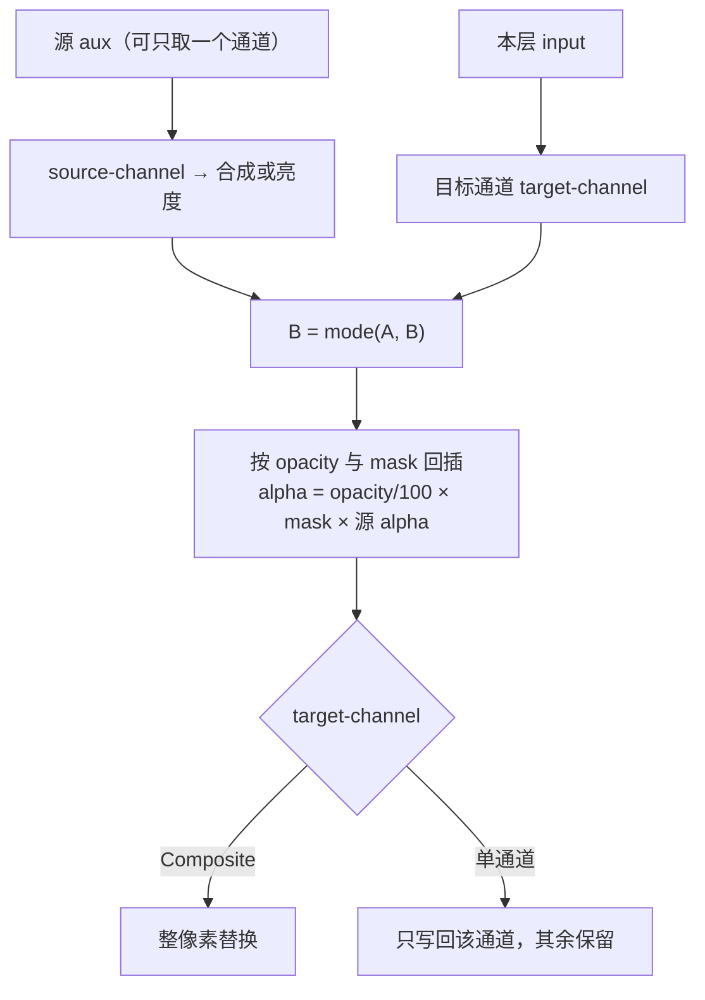

# Apply Image · 应用图像

> `lb:apply-image` · 菜单 **SuperMrWang → Blend → Apply Image** · 双输入（input + aux）

对应 经典图像编辑器的 **图像 → 应用图像**：把一张图（另一个图层 / 另一个文件）当作源，
按混合模式、不透明度、遮罩压到当前图层上，还可以只作用于某一个通道。

Replicates the classic editor's **Image → Apply Image**: takes a second image as the source,
blends it onto the current layer with a blend mode, opacity and mask, optionally
into a single channel.

## 参数 / Parameters

| 参数 | 默认 | 说明 |
|---|---|---|
| `blend-mode` | Multiply | 26 种混合模式，顺序与经典图像编辑器一致（Normal … Divide、Darker/Lighter Color、Hue … Luminosity） |
| `scale` | 1.0 | **仅加法/减法**：结果 = (A ± B) / 缩放 + 补偿值，范围 1.0..2.0 |
| `offset` | 0 | **仅加法/减法**：缩放后加上的补偿值，±255（8bit 口径） |
| `opacity` | 100 | 混合强度，0 = 不动，100 = 完全应用 |
| `target-channel` | Composite | 结果写回哪个通道；可选整个合成或单个 R/G/B/亮度/Alpha |
| `source-channel` | Composite | 从 aux 取哪个通道作为源 |
| `mask-enabled` | 否 | 用一路通道当遮罩 |
| `mask-from` | Source layer | 遮罩取自 aux 还是本层 |
| `mask-channel` | Composite | 遮罩通道（Composite 取亮度） |
| `invert-mask` | 否 | 遮罩反相 |
| `preserve-transparency` | 否 | 全透明像素保持不动（经典图像编辑器的「保留透明区域」） |
| `output-mode` | Composite | 输出合成结果 / 灰蒙版 / alpha 蒙版 |

## 算法



```math
\text{out} = (1-\alpha)\,A + \alpha\,B_{\text{mode}}(A,B),\qquad
\alpha = \frac{\text{opacity}}{100}\cdot m\cdot\alpha_{\text{src}}
```

```math
\text{add/sub:}\quad \text{out} = \operatorname{clamp}\!\left(\frac{A \pm B}{\text{scale}} + \frac{\text{offset}}{255},\ 0,\ 1\right)
```

## 与 经典图像编辑器的对应关系 / How it maps to 经典图像编辑器

| 经典图像编辑器 | 这里 |
|---|---|
| Source: 图像 + 图层 | `aux` pad，在滤镜对话框里选 |
| Source: 通道 | `source-channel` |
| Target: 通道 | `target-channel` |
| Blending / Opacity | `blend-mode` / `opacity` |
| 加法/减法 的 Scale / Offset | `scale` / `offset` |
| Preserve Transparency | `preserve-transparency` |
| Mask: 图层 + 通道 + 反相 | `mask-from` + `mask-channel` + `invert-mask` |

经典图像编辑器的遮罩可以指向**第三张**图（既不是目标也不是源），GEGL 的 composer 只有
两个输入，所以这里限定在「本层」或「源层」二选一——实际用法里这两处覆盖了
绝大多数场合。

## 行为细节 / Behaviour notes

- **aux 没接时**源退化为本图，可以用来做「同图内通道互混」；
  Without an aux connected the source falls back to the input itself.
- **源层的透明像素（alpha = 0）不参与作用**：源层是抠图、文字层或带透明背景
  的图层时，透明区的 RGB 是 0，照常混合会把目标乘成黑色。alpha 同时当作覆盖率，
  半透明的柔边会渐隐而不是留硬边。
  Transparent source pixels take no part: on a cut-out or text layer the holes
  hold RGB 0, which would blacken the target under multiply. The alpha doubles
  as coverage, so soft mattes fade instead of leaving a hard edge.
- 目标是单通道时只改那一个通道，其余原样保留；源是合成时取亮度作标量。
  With a single-channel target only that channel changes; a composite source is
  reduced to luminance.
- 深色 / 浅色（Darker / Lighter Color）比较整像素亮度后取其中一方**全部通道**，
  不是逐通道取最小/最大——这一点和「变暗 / 变亮」不同。
- 在 8bit sRGB 伽马域计算，与 经典图像编辑器的混合模式定义同域；结果会裁到 0..1。
- GIMP 里这类带 aux 的滤镜目前**只能合并应用**，不能保存成非破坏性 fx。

```bash
./build.sh              # 顺带编译出 build/auxrun（双输入 runner）
```

## 源图层的尺寸与位置 / Source layer size and position

经典图像编辑器的应用图像要求两个图层**像素尺寸完全一致**，尺寸不同时源图层直接灰掉；
GIMP 里图层可以比画布小、也可以带偏移，所以这里得自己定规则：

- 算子按 `aux` 缓冲区自己的 extent（即源图层的大小和位置）做**粗筛**，没盖到
  的像素原样输出；
- 盖到的范围内，再由源像素的 alpha 决定**真正有没有像素**：alpha = 0 的地方
  原样输出，alpha 介于 0 和 1 之间按覆盖率减弱。只有「既属于源层、又有像素」
  的地方才被改动，这才是经典图像编辑器意义上「只有相交部分起作用」。

早先版本用的是 `GeglOperationPointComposer`，`process` 只拿到一段裸指针，
看不到 aux 的 extent，界外被 GEGL 补成透明黑再参与混合：正片叠底会把外侧涂
黑，正常模式会把外侧擦成透明。改成 `GeglOperationComposer` 后 `process` 拿到
的是真正的 `GeglBuffer`，`gegl_buffer_get_extent(aux)` 就能取到图层尺寸，
`tools/auxrun` 也补了 `aux-x` / `aux-y` 用来模拟带偏移的源层。

extent 只能说明「这块地方属于源层」，说明不了「这块地方有像素」——抠图的透明
洞也在 extent 里面，光看 extent 会把洞一起乘黑。所以两者要配合用。

the classic editor requires both layers to have exactly the same pixel size and greys the
source out otherwise; GIMP layers may be smaller than the canvas or offset, so
the rule here is two-stage: the aux buffer's own extent is the coarse filter,
and the source alpha decides which pixels inside that area really carry pixels.
Uncovered and transparent pixels are passed through untouched. The older
point-composer version only received a raw pointer for the aux, could not see
its extent, and treated the outside as transparent black — multiply blackened
it, normal erased it. The extent alone is not enough: a cut-out's holes lie
inside the extent, so pure extent logic would still blacken them.

## 测试 / Testing

```bash
./build.sh
python tools/check_blend.py     # 26 个用例，其中 19 个属于应用图像：混合模式、遮罩、
                               # 通道、源层尺寸/偏移、源层透明与半透明覆盖率
```

the classic editor's mask may point at a *third* image. A GEGL composer only exposes two inputs,
so the mask is limited to either the target or the source, which covers the
common cases.
