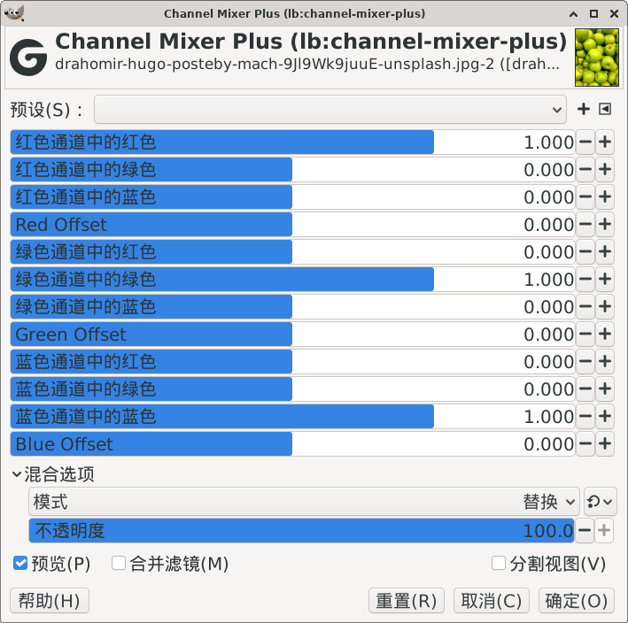

> 本文件是该滤镜的原始说明文档（构建命令按旧目录结构书写，已过时）。
> 统一构建方式请见工程根目录 `README.md` 与 `build.sh`。

# GEGL_GIMP_PLUGIN_channnel-mixer-plus



## English

### 1. Compile & Install Commands

#### Native Linux (System installed GIMP)

```bash
sh build_linux.sh
cp build/gegl-*.so ~/.local/share/gegl-0.4/plug-ins
```

#### Flatpak Linux (Flatpak GIMP)

```bash
sh build_linux.sh
cp build/gegl-*.so ~/.var/app/org.gimp.GIMP/data/gegl-0.4/plug-ins/
```

### 2. How to Open the Plugin (2 Methods)

After installation, **restart GIMP** to activate the plugin.

#### Method 1: Menu Bar (Recommended)

Menu path: `Colors → SuperMrWang → Blend → Channel Mixer Plus`

#### Method 2: GEGL Operation

1. Go to `Filters → Generic → GEGL Operations`
2. In the search box, enter: `lb:channel-mixer-plus`
3. Select it and click `OK` to apply

---

## 中文

### 1. 编译与安装命令

#### Linux 原生版（系统包安装的GIMP）

```bash
sh build_linux.sh
cp build/gegl-*.so ~/.local/share/gegl-0.4/plug-ins
```

#### Linux Flatpak 容器版（应用商店Flatpak GIMP）

```bash
sh build_linux.sh
cp build/gegl-*.so ~/.var/app/org.gimp.GIMP/data/gegl-0.4/plug-ins/
```

### 2. 插件打开方式（两种方法）

安装完成后**重启 GIMP**，插件即可使用。

#### 方法一：菜单打开（推荐）

菜单路径：`SuperMrWang → Blend → Channel Mixer Plus`

#### 方法二：GEGL 操作打开

1. 顶部菜单点击：`滤镜 → 通用 → GEGL 操作`
2. 在弹出窗口的搜索框输入：`lb:channel-mixer-plus`
3. 选中后点击「确定」即可使用插件

---

## 算法

每路输出通道都是 RGB 三源通道的加权和，再加该通道自己的常数项：

```math
\begin{aligned}
R' &= r_r\,R + r_g\,G + r_b\,B + r_{\text{off}} \\
G' &= g_r\,R + g_g\,G + g_b\,B + g_{\text{off}} \\
B' &= b_r\,R + b_g\,G + b_b\,B + b_{\text{off}}
\end{aligned}
```

默认是单位矩阵（对角 1、其余 0）、常数全 0，所以什么都不动时算子等于直通。
结果裁到 0..1。增益允许 −2…2，既能加也能减某个通道。

## 单色

`monochrome` 打开后三路共用一组系数（`mono_r` / `mono_g` / `mono_b`，默认
0.33 / 0.33 / 0.34）加一个 `mono_offset`，输出灰图——就是 经典图像编辑器 那个单色勾选框。
此时逐通道矩阵被忽略，两套设置可以共存，来回切换不丢。

## 参数

| 参数 | 默认 | 说明 |
|---|---|---|
| `monochrome` | 关 | 单组系数出灰（经典图像编辑器 单色） |
| `mono_r` / `mono_g` / `mono_b` | 0.33 / 0.33 / 0.34 | 单色权重，默认和为 1 |
| `mono_offset` | 0 | 单色常数 |
| `rr_gain` / `rg_gain` / `rb_gain` | 1 / 0 / 0 | 输出 R 取 R / G / B 的权重 |
| `gr_gain` / `gg_gain` / `gb_gain` | 0 / 1 / 0 | 输出 G 的三个权重 |
| `r_offset` / `g_offset` / `b_offset` | 0 | 各输出通道的常数项 |

## 与 GEGL 内置 channel-mixer 的差别

GEGL 自带 `gegl:channel-mixer`，矩阵是一样的，但没有每通道常数，多一个
「保持明度」。本算子补上常数项（就是 经典图像编辑器的「常数」滑杆），去掉保持明度：
加完常数再按亮度缩放，两个方向会互相拉扯。

## 验证

`python tools/check_gamma_domain.py`：单位矩阵下算子必须原样通过探针图。
