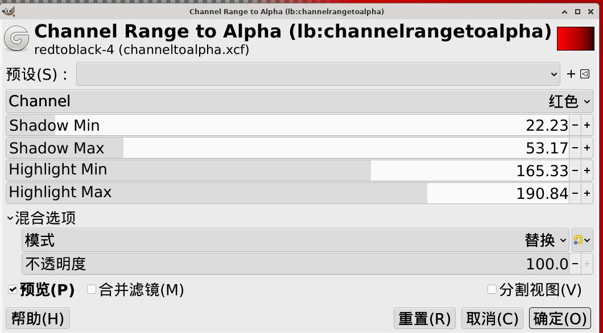

> 本文件是该滤镜的原始说明文档（构建命令按旧目录结构书写，已过时）。
> 统一构建方式请见工程根目录 `README.md` 与 `build.sh`。

# GEGL_GIMP_PLUGIN_channelrangetoalpha




## English

### 1. Compile & Install Commands

#### Native Linux (System installed GIMP)

```bash
sh build_linux.sh
cp build/gegl-*.so ~/.local/share/gegl-0.4/plug-ins
```

#### Flatpak Linux (Flatpak GIMP)

```bash
sh build_linux.sh
cp build/gegl-*.so ~/.var/app/org.gimp.GIMP/data/gegl-0.4/plug-ins/
```

### 2. How to Open the Plugin (2 Methods)

After installation, **restart GIMP** to activate the plugin.

#### Method 1: Menu Bar (Recommended)

Menu path: `Colors → SuperMrWang → Mask → Range → Alpha`

#### Method 2: GEGL Operation

1. Go to `Filters → Generic → GEGL Operations`
2. In the search box, enter: `lb:channel-range-to-alpha`
3. Select it and click `OK` to apply

---

## 中文

### 1. 编译与安装命令

#### Linux 原生版（系统包安装的GIMP）

```bash
sh build_linux.sh
cp build/gegl-*.so ~/.local/share/gegl-0.4/plug-ins
```

#### Linux Flatpak 容器版（应用商店Flatpak GIMP）

```bash
sh build_linux.sh
cp build/gegl-*.so ~/.var/app/org.gimp.GIMP/data/gegl-0.4/plug-ins/
```

### 2. 插件打开方式（两种方法）

安装完成后**重启 GIMP**，插件即可使用。

#### 方法一：菜单打开（推荐）

菜单路径：`颜色 → SuperMrWang → Mask → Range → Alpha`

#### 方法二：GEGL 操作打开

1. 顶部菜单点击：`滤镜 → 通用 → GEGL 操作`
2. 在弹出窗口的搜索框输入：`lb:channel-range-to-alpha`
3. 选中后点击「确定」即可使用插件

---

## 算法

选一路通道，划出一段「不透明区间」，区间外按线性斜坡淡出——即 经典图像编辑器的
**混合颜色带**（图层样式里的「混合颜色带：灰色」那对滑杆）单独做成算子。

```
x < l1  或  x > r2        -> alpha = 0
l2 <= x <= r1             -> alpha = 1
l1 <= x <  l2             -> alpha = (x - l1) / (l2 - l1)
r1 <  x <= r2             -> alpha = 1 - (x - r1) / (r2 - r1)
```

`l1 → l2` 是阴影侧斜坡，`r1 → r2` 是高光侧斜坡。两个滑块重合（`l1 = l2` 或
`r1 = r2`）就是硬边，不是需要修复的退化情形。

## 通道

| `channel` | 映射到 0–255 滑块刻度的量 |
|---|---|
| `red` / `green` / `blue` | 伽马编码值 × 255 |
| `gray` | 0.299 R + 0.587 G + 0.114 B，× 255 |
| `lab-l` | L\*（0…100）归一到 0…255 |
| `lab-a` | a\*（−128…127）归一到 0…255 |
| `lab-b` | b\*（−128…127）归一到 0…255 |

LAB 在算子内部算（sRGB → XYZ（D65 矩阵）→ L\*a\*b\*），管线里不用再接转换节点。
滑块按 8 位 0–255 标定，所以算子要求伽马编码的采样值：喂线性光，整个区间会平移。

## 行为细节

- **滑块重合只表示硬边。** 早先版本会把重合的滑块强行拉开一个最小步长，结果
  默认参数（0/0 与 255/255）凭空多出一段羽化带，通道值为 0 的像素不动任何滑块
  就变透明。2026-11-12 已修。
- 每组滑块先排序再使用，`l1 > l2` 不会把斜坡反过来。
- alpha ≤ 0 的像素透传；其余情况 alpha 是**乘**进原有 alpha，而不是替换。
- 逐像素、无邻域，拖滑杆足够快。
