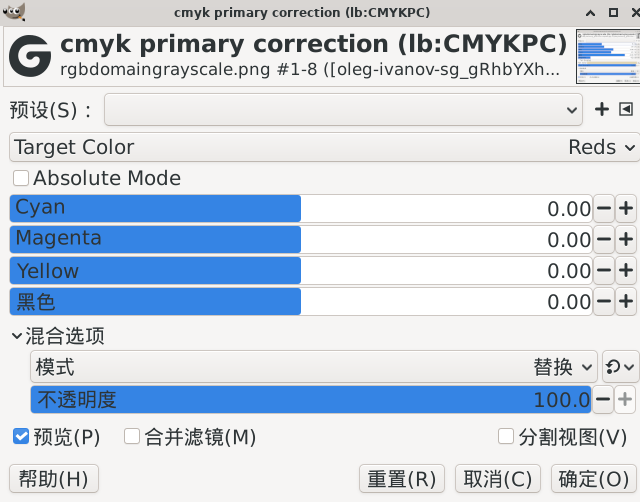

> 本文件是该滤镜的原始说明文档（构建命令按旧目录结构书写，已过时）。
> 统一构建方式请见工程根目录 `README.md` 与 `build.sh`。

# GEGL_GIMP_PLUGIN_cmyk-primary-correction


cmyk-primary-correction

## English

### 1. Compile & Install Commands

#### Native Linux (System installed GIMP)

```bash
sh build_linux.sh
cp build/gegl-*.so ~/.local/share/gegl-0.4/plug-ins
```

#### Flatpak Linux (Flatpak GIMP)

```bash
sh build_linux.sh
cp build/gegl-*.so ~/.var/app/org.gimp.GIMP/data/gegl-0.4/plug-ins/
```

### 2. How to Open the Plugin (2 Methods)

After installation, **restart GIMP** to activate the plugin.

#### Method 1: Menu Bar (Recommended)

Menu path: `Colors → SuperMrWang → Channel Range To Alpha`

#### Method 2: GEGL Operation

1. Go to `Filters → Generic → GEGL Operations`
2. In the search box, enter: `cmykprimarycorrection`
3. Select it and click `OK` to apply

---

## 中文

### 1. 编译与安装命令

#### Linux 原生版（系统包安装的GIMP）

```bash
sh build_linux.sh
cp build/gegl-*.so ~/.local/share/gegl-0.4/plug-ins
```

#### Linux Flatpak 容器版（应用商店Flatpak GIMP）

```bash
sh build_linux.sh
cp build/gegl-*.so ~/.var/app/org.gimp.GIMP/data/gegl-0.4/plug-ins/
```

### 2. 插件打开方式（两种方法）

安装完成后**重启 GIMP**，插件即可使用。

#### 方法一：菜单打开（推荐）

菜单路径：`颜色 → SuperMrWang → cmykprimarycorrection`

#### 方法二：GEGL 操作打开

1. 顶部菜单点击：`滤镜 → 通用 → GEGL 操作`
2. 在弹出窗口的搜索框输入：`cmyk-primary-correction`
3. 选中后点击「确定」即可使用插件

---

## 参数说明（本工程版本）

与 Photoshop「可选颜色」一致，**九个色域各存一份独立的 C/M/Y/K**，切换查看不会
覆盖别组的数值，九组同时对整图生效（一个像素同时落在「红」和「白」时两组都起作用）。

- 滑块按「色域 – 墨量」命名：`Reds – Cyan`、`Yellows – Magenta`、… 共 9 × 4 = 36 个，
  顺序与 PS 页签一致：红 → 黄 → 绿 → 青 → 蓝 → 品红 → 白 → 中性 → 黑
- `Absolute Mode`：对应 PS 的「绝对」复选框
- 数值范围 -100 ~ +100，与 PS 滑块同刻度

> 注：本机 GEGL 0.4.72 不支持 `property_group`，所以 36 个滑块在面板里是平铺的，
> 靠名字前缀区分色域；等 GEGL 升级后可以改成折叠分组。

回归验证脚本：`python tools/check_cmyk_sections.py`（校验单组结果与旧版逐像素一致、
多组同时生效互不覆盖）。
