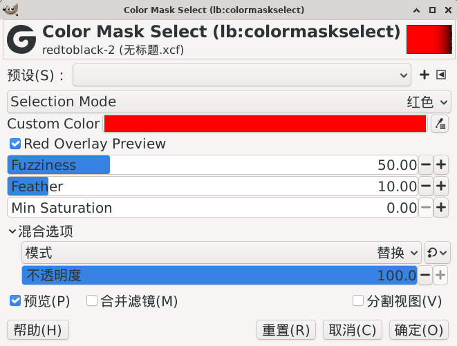

> 本文件是该滤镜的原始说明文档（构建命令按旧目录结构书写，已过时）。
> 统一构建方式请见工程根目录 `README.md` 与 `build.sh`。

# GEGL_GIMP_PLUGIN_color-mask-select



## English

### 1. Compile & Install Commands

#### Native Linux (System installed GIMP)

```bash
sh build_linux.sh
cp build/gegl-*.so ~/.local/share/gegl-0.4/plug-ins
```

#### Flatpak Linux (Flatpak GIMP)

```bash
sh build_linux.sh
cp build/gegl-*.so ~/.var/app/org.gimp.GIMP/data/gegl-0.4/plug-ins/
```

### 2. How to Open the Plugin (2 Methods)

After installation, **restart GIMP** to activate the plugin.

#### Method 1: Menu Bar (Recommended)

Menu path: `Colors → SuperMrWang → Mask by Color`

#### Method 2: GEGL Operation

1. Go to `Filters → Generic → GEGL Operations`
2. In the search box, enter: `lb:color-mask-select`
3. Select it and click `OK` to apply

---

## 中文

### 1. 编译与安装命令

#### Linux 原生版（系统包安装的GIMP）

```bash
sh build_linux.sh
cp build/gegl-*.so ~/.local/share/gegl-0.4/plug-ins
```

#### Linux Flatpak 容器版（应用商店Flatpak GIMP）

```bash
sh build_linux.sh
cp build/gegl-*.so ~/.var/app/org.gimp.GIMP/data/gegl-0.4/plug-ins/
```

### 2. 插件打开方式（两种方法）

安装完成后**重启 GIMP**，插件即可使用。

#### 方法一：菜单打开（推荐）

菜单路径：`颜色 → SuperMrWang → Mask by Color`

#### 方法二：GEGL 操作打开

1. 顶部菜单点击：`滤镜 → 通用 → GEGL 操作`
2. 在弹出窗口的搜索框输入：`lb:color-mask-select`
3. 选中后点击「确定」即可使用插件

---

## 行为变更记录（2026-11-12 重写）

旧实现有一个致命 bug：默认 `Min Saturation = 0` 时饱和度门限退化成
`smooth_step(s, 0, 0)`，对灰阶像素（s = 0）做 0/0 得 NaN，alpha 落盘即 0——
所有灰阶在任何模式下都被判成透明，白/黑/中间调三个模式整体报废；`fuzziness = 0`
时同样 NaN。判定公式（通道差值 + 负起点过渡带）也让「容差」的含义随模式漂移。

重写后的统一模型：每个模式把像素映射成「不匹配度」 d ∈ [0,1]（0 = 精确匹配），
`alpha = 1 - smoothstep(d, w*(1-feather), w)`，其中 **w = fuzziness/200**
（fz=200 时窗宽到最大不匹配度：互补色相、纯黑↔纯白）：

| 模式 | d 的定义 |
|---|---|
| 红/黄/绿/青/蓝/洋红 | 色环距离（互补色 = 1），乘饱和度门限——灰阶无色相不参与 |
| 高光 | d = 1 − 亮度 |
| 阴影 | d = 亮度 |
| 中间调 | d = 2·\|亮度 − 0.5\| |
| 自定颜色 | 感知 RGB 距离 ÷ √3 |

- feather（0–100）：容差窗内缘的过渡带宽度，feather=10 → 窗口内侧 10% 平滑衰减
- Min Saturation：色系预设的饱和度下限，0 = 固定小底限
- Invert（新增）：反相蒙版，同 PS 的「反相」勾选框
- Red Overlay Preview 默认改为关：开着点确定会把红色混合烤进图层，预览完记得关

16 色块回归：红/黄/白/黑/中间调/自定/反相/fz0/fz200 九个用例全部符合上表语义。
