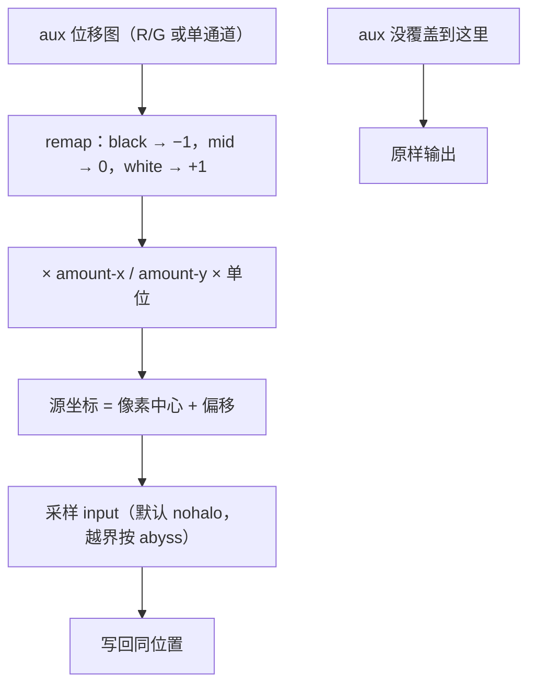

# Displace · 置换

> `lb:displace` · 菜单 **SuperMrWang → Distort → Displace** · 双输入（input + aux）

按位移图重采样图像。GEGL 自带的 `gegl:displace` 能跑，但参数面被写死在几处地方，
这个算子把它们逐个打开。

Resamples the image through a displacement map. GEGL's own `gegl:displace` works,
but several of its knobs are welded shut; this one opens them.

## 为什么不用 gegl:displace

`gegl:displace` 每像素算的是 `2 × amount × (Y′ − 0.5) × alpha`，aux 的格式是
`Y'A float`。这一行决定了它的全部性格：

GEGL's displace computes `2 × amount × (Y′ − 0.5) × alpha` per pixel, with the
map read as `Y'A float`. That single line defines its whole character:

| 项 | `gegl:displace` | `lb:displace` |
|---|---|---|
| 位移图读法 | 只取亮度 Y′；水平、垂直各要**一张图** | 矢量场取 R→X、G→Y，**一张图**同时给两轴；也可切单通道模式 |
| alpha | 强制相乘，位移图透明处位移静默归零 | 默认不乘，`alpha-weight` 显式打开 |
| 中性值 | 固定 0.5，不可改 | `midpoint` 可调，另有 `black-point` / `white-point` 做动态范围压缩与超量位移 |
| 单位 | 像素 | 像素 或 **长边百分比**（换分辨率不用重调） |
| 越界 | clamp / loop / black / white | 同上，另加 **transparent** |
| 重采样 | 默认 bicubic，高对比边缘会振铃出白边 | 默认 **nohalo**，可换 bilinear / cubic / lohalo |
| 位移图未覆盖区 | 读出 0 → 整块被硬移 −amount | **原样输出** |
| 输出尺寸 | 跟随主图 | 跟随主图（显式覆盖 bbox，位移图偏移不会撑大画布） |

前两条最要命：拿一张带透明背景的图层当位移图，`gegl:displace` 会在透明处**不报错地**
取消位移；想同时控制 X 和 Y 又得准备两张对齐的灰度图。这里一张 RGBA 就够。

The first two matter most: with a layer that has transparency as the map,
`gegl:displace` silently cancels the displacement there, and driving both axes
needs two perfectly aligned greyscale images. Here one RGBA map does both.

## 参数 / Parameters

| 参数 | 默认 | 说明 |
|---|---|---|
| `amount-x` | 0 | 水平位移量，对应位移图白场处 |
| `amount-y` | 0 | 垂直位移量，对应位移图白场处 |
| `units` | Pixels | `Pixels` 固定像素；`Percent of long edge` 按主图长边百分比 |
| `map-mode` | Vector | `Vector` 取 R→X、G→Y；`Single channel` 取一个通道同时喂两轴 |
| `map-channel` | Luminance | 单通道模式读哪个通道（亮度 / R / G / B / A） |
| `black-point` | 0 | 位移图取这个值时是 −1 倍位移 |
| `midpoint` | 0.5 | 位移图取这个值时不动。灰图用 0.5，零中性矢量场用 0 |
| `white-point` | 1 | 位移图取这个值时是 +1 倍位移 |
| `alpha-weight` | 否 | 位移量乘以位移图的 alpha（复刻 `gegl:displace` 的行为） |
| `abyss` | Wrap around | 采到图外时：环绕 / 重复边缘 / 透明 / 黑 / 白 |
| `resampling` | Nohalo | 最近邻 / 双线性 / 双三次 / Nohalo / Lohalo |

`black-point`、`midpoint`、`white-point` 三个一起决定映射曲线：**中点两侧各自**线性
映射到 −1 和 +1。所以 `0 / 0.5 / 1` 是标准灰图，`−1 / 0 / 1` 是零中性矢量场，
`0.2 / 0.4 / 0.6` 则是「只取中间一段做完整位移」，相当于先把位移图加对比度。

Together the three mapping points put −1 at black, 0 at the midpoint and +1 at
white, **each side scaled independently**. `0 / 0.5 / 1` is a plain grey map,
`−1 / 0 / 1` is a zero-centred vector field, and `0.2 / 0.4 / 0.6` stretches a
narrow band of the map into the full range.

## 算法



```math
t(v)=\begin{cases}\dfrac{v-\text{mid}}{\text{white}-\text{mid}} & v\ge \text{mid}\\[4pt]
\dfrac{v-\text{mid}}{\text{mid}-\text{black}} & v<\text{mid}\end{cases}
\qquad
\text{src}=(x+\tfrac12+t_x A_x u,\; y+\tfrac12+t_y A_y u)
```

`u` 是单位换算（像素时 1，百分比时长边 × 0.01）。矢量模式下 `t_x=t(R)`、`t_y=t(G)`；
单通道模式下两者取同一个 `t`，方向由 `amount-x` 与 `amount-y` 的比值决定。

Here `u` is the unit factor (1 for pixels, long edge × 0.01 for percent). Vector
mode uses `t(R)` and `t(G)`; single channel mode feeds one `t` to both axes, so
the ratio of the two amounts picks the direction.

## 用法 / Recipes

- **水波、热浪**：`gegl:perlin-noise` 当位移图，`midpoint=0`（噪声以 0 为中心）、
  `amount` 10–30 px，`resampling=nohalo`。
- **无缝贴图的接缝**：位移图也要是无缝的，`abyss=Wrap around`，否则拉伸后接缝会
  出现在另一个位置。
- **镜头桶形逆映射**：用 `gegl:lens-distortion` 的反向参数生成一张坐标场，切
  `map-mode=Single channel` 只能处理同心圆，真正要按半径算还是得用矢量图。
- **文字磨损 / 涂抹**：`amount` 大（>50 px）时把 `resampling` 提到 `Lohalo`，
  并在位移图上先做一次轻微高斯模糊——硬边的位移图会把边缘采样成锯齿。

## 与 gegl:displace 的迁移

把原来的「两张灰度图」换成「一张 RGBA」：R 放水平图、G 放垂直图，两个都按
`0 / 0.5 / 1` 保持中灰不动。如果只有一张灰度图，切 `map-mode=Single channel`、
`map-channel=Luminance`，`amount-x` 与 `amount-y` 分别填原来的两个比例即可。

Move the two greyscale maps into one RGBA map: R takes the horizontal map, G the
vertical one, both still resting at mid grey. With a single grey map, switch to
single channel mode and put the two old ratios into the two amounts.

## 测试 / Testing

```bash
python tools/check_displace.py -v
```

11 项逐像素断言：零位移恒等、黑白满量位移、环绕与夹边的区别、矢量场 XY 独立、
单通道模式、百分比单位、白场外推、透明位移图默认仍然生效、勾上 `alpha-weight`
后透明区不动、位移图只盖半个画面时未覆盖区原样。
