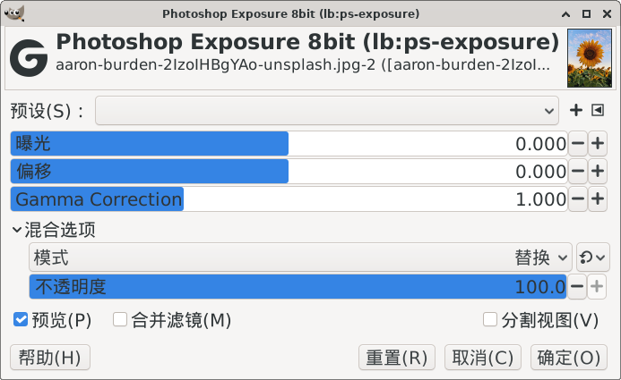

> 本文件是该滤镜的原始说明文档（构建命令按旧目录结构书写，已过时）。
> 统一构建方式请见工程根目录 `README.md` 与 `build.sh`。

# GEGL_GIMP_PLUGIN_ps-exposure



## English

### 1. Compile & Install Commands

#### Native Linux (System installed GIMP)

```bash
sh build_linux.sh
cp build/gegl-*.so ~/.local/share/gegl-0.4/plug-ins
```

#### Flatpak Linux (Flatpak GIMP)

```bash
sh build_linux.sh
cp build/gegl-*.so ~/.var/app/org.gimp.GIMP/data/gegl-0.4/plug-ins/
```

### 2. How to Open the Plugin (2 Methods)

After installation, **restart GIMP** to activate the plugin.

#### Method 1: Menu Bar (Recommended)

Menu path: `Colors → SuperMrWang → Tone → Exposure EV`

#### Method 2: GEGL Operation

1. Go to `Filters → Generic → GEGL Operations`
2. In the search box, enter: `lb:exposure`
3. Select it and click `OK` to apply

---

## 中文

### 1. 编译与安装命令

#### Linux 原生版（系统包安装的GIMP）

```bash
sh build_linux.sh
cp build/gegl-*.so ~/.local/share/gegl-0.4/plug-ins
```

#### Linux Flatpak 容器版（应用商店Flatpak GIMP）

```bash
sh build_linux.sh
cp build/gegl-*.so ~/.var/app/org.gimp.GIMP/data/gegl-0.4/plug-ins/
```

### 2. 插件打开方式（两种方法）

安装完成后**重启 GIMP**，插件即可使用。

#### 方法一：菜单打开（推荐）

菜单路径：`颜色 → SuperMrWang → Tone → Exposure EV`

#### 方法二：GEGL 操作打开

1. 顶部菜单点击：`滤镜 → 通用 → GEGL 操作`
2. 在弹出窗口的搜索框输入：`lb:exposure`
3. 选中后点击「确定」即可使用插件

---

## 两条公式，按输入精度自动选路

`precision` 属性：`auto`（默认）/ `encoded`（强制 8 位）/ `linear`（强制 32 位）。
auto 读输入 pad 的源格式：整数格式（`u8` / `u16`）走分支一，浮点格式
（`float` / `half` / `double`）走分支二。16 位图同样是伽马编码，所以和 8 位共用
分支一。

### 分支一：整数格式（sRGB 伽马编码值）

```
v1 = min(c · 2^(EV/2.2), 1)
v2 = clamp(v1^2.2 + offset, 0, 1)^(1/2.2)
v3 = v2^(1/gamma)
```

在伽马域乘 `2^(EV/2.2)` 与线性光乘 `2^EV` 完全等价，省掉两次幂运算；`offset`
是线性光下的量，所以中间解一次 2.2、加完再编码回去。

**`min(…, 1)` 不能省。** 先切高光再叠 offset，负 offset 才能把过曝区拉回来；
漏掉这步，`EV>0` 配负 offset 会把整片亮区顶成死白。旧版实现漏了这一行。

### 分支二：浮点格式（线性光）

```
v1 = c · 2^EV + offset
v2 = clamp(v1, 0, ∞)^(1/gamma)
```

输入已是线性光，没有 2.2 往返；曝光就是一次乘法，offset 直接相加。

**与 Java 版的一处差别**：Java 末尾有 `clamp(…, 0, 1)`，本算子只钳下限。
32 位图允许 HDR，按 0…1 截断会把高光压平；负值必须钳掉，否则 `pow` 出 NaN。

## 验收

```bash
python tools/check_exposure.py
```

12 组参数（EV −3…+2、offset ±0.15、gamma 0.45…2.2）× 64 级灰阶：

- 分支一对拍 Java `exposureChannel`：最大 **0.00 码**
- 分支二对拍 Java `exposureChannel2`：最大 **0.00 码**
- 整数 PNG 输入下 `auto` 与 `encoded` 逐像素完全相同（0 处不同）
- 浮点 EXR 输入下 `auto` 与 `linear` 完全相同，与 `encoded` 在 2944 个像素上不同
  —— 说明 auto 真的切了分支，而不只是多了个开关
