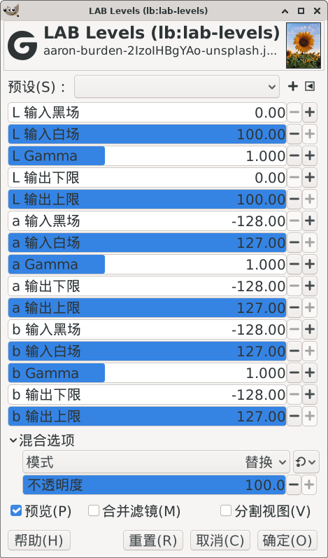

# LAB Levels（lb:lab-levels）



菜单：`颜色 → SuperMrWang → Levels → LAB Levels`（Filter 类）

## 概述

对 CIELAB 的 L/a/b 三个通道各自做独立的色阶调整：输入黑场/白场、gamma、
输出下限/上限。L 管明度，a（绿−洋红）与 b（蓝−黄）管色彩倾向——
调整 a/b 时明度和中性色都不受影响，这是它与 RGB 色阶的本质差异。

## 色彩空间

算子直接工作在 babl 的 `CIE Lab alpha float`（**D50 白点**）上，
RGB↔Lab 交给 babl——数值口径与 GIMP 原生 Lab 工具（指针、曲线的 Lab 模式）
及 `lb:match-color` 一致。在 Lab 域做 levels 等价于感知域映射，
不依赖"线性光"前提（历史版本自带 D65 线性 RGB→XYZ 转换，已废弃）。

```math
x \leftarrow \operatorname{clamp}(x,\ i_{\text{lo}},\ i_{\text{hi}}),\qquad
x' = \begin{cases}
o_{\text{lo}} + u_{-}^{1/\gamma}\,\bigl(0 - o_{\text{lo}}\bigr), & x < 0,\quad u_{-} = \dfrac{x - i_{\text{lo}}}{0 - i_{\text{lo}}} \\[12pt]
o_{\text{hi}}\,u_{+}^{1/\gamma}, & x \ge 0,\quad u_{+} = \dfrac{x}{i_{\text{hi}}}
\end{cases}
```

两个半轴各自归一到 $[0,1]$ 再做 gamma，所以 $x = 0$（中性轴）在任意 $\gamma$
下都不动。

## 规则细则

- **a/b 的 gamma 绕中性轴 0 转动**：负半轴 `[in_black, 0]` 与正半轴
  `[0, in_white]` 各自归一化后做 gamma。中性像素（a=b=0 的灰白）在任意
  gamma 下保持不动；拖 a/b gamma 只改变彩色中间调的倾向强度。
- **黑白场交叉自动交换**：输入黑场拉过白场（或反之）时按交换后的范围映射，
  不会塌成单色。
- **输出反向（负片）可用**：输出下限 > 上限时做反向映射，clamp 到真实
  上下界——L 反转即明度负片，a/b 反转即色度负片。
- **alpha ≤ 0 像素原样透传**，alpha 通道始终保留。
- L 的削顶范围 `[0, 100]`，a/b 为 `[-128, 127]`，输出自动 clamp。
- L 的 gamma 是标准色阶语义（绕输入范围中点），与 a/b 的绕中性轴不同。

## 性能

levels 映射为 1D 单调函数，process 时为 L、a/b（负/正半轴各一）建立
4096 项查找表，逐像素查表 + 线性插值，无逐像素 `powf`。a/b 拆半轴建表是
因为绕轴映射在 0 处导数不连续，跨 0 插值会把中性附近的微小输入过冲放大
（曾导致 +0.03 被插成 +1.95）。表每次 process 确定性重建，跨块一致。

## 验证

`tools/check_lab_levels.py`（21 项，gimp-console 运行）：恒等、灰白中性
保持、gamma 增强/减弱、黑白场重映射与削顶、输出反向单调性、交叉交换、
透明透传、alpha 保留、组合参数整体校验。期望值由 Python 镜像同一套
levels 规则逐像素比对（输入以 Lab 格式建缓冲，镜像与算子看同一份数值）。

```bash
"D:/fastsoftware/GIMP 3/bin/gimp-console-3.2.exe" -i -c -d -f \
    --batch-interpreter=python-fu-eval \
    -b "exec(open(r'<repo>/tools/check_lab_levels.py').read())" --quit
```

## 已知事项

- a/b gamma≠1 时中性附近的微小色度会被放大（gamma=2 时 0.008 → 1.0），
  这是绕轴 gamma 曲线本身的形状（近中性斜率大），经典图像编辑器 同类操作一致；
  对噪声明显的图建议配合蒙版或较小 gamma 使用。
- 相比旧版（自带 D65 转换），同一输入的数值结果会有轻微差异（白点口径
  从 D65 变为 D50），旧 XCF 中挂载的本滤镜输出会略有不同。
