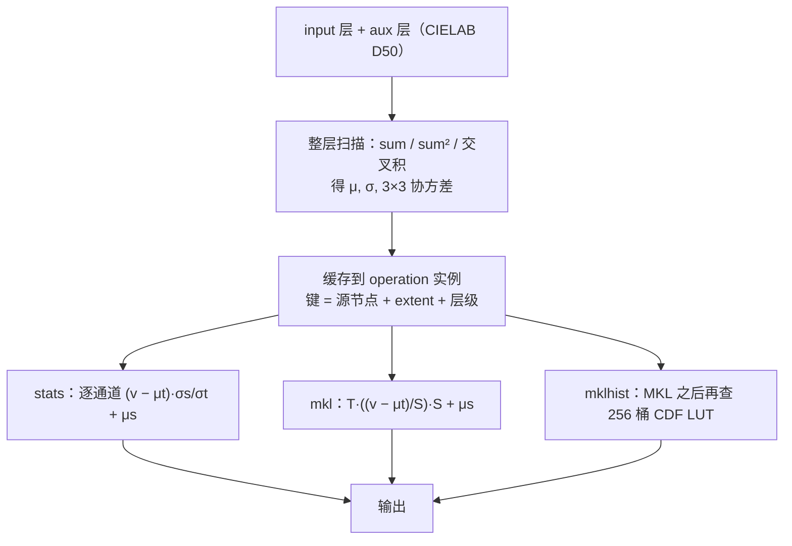

# Match Color（lb:match-color）

经典图像编辑器的「图像 → 调整 → 匹配颜色」的复刻：把**另一张图 / 另一个图层**的
颜色统计量迁移到本层。默认的「统计」方法就是 经典图像编辑器 的行为（Reinhard 等
2001 年的 L\*a\*b\* 均值-方差仿射迁移）；另外两档是公开文献里成熟、比它更好用的
算法，做成了 `method` 下拉框。

## 模型

工作在 CIELAB（D50）里，`method` 三选一。

**① 统计（`stats`，默认）**——逐通道均值/标准差仿射映射，与 经典图像编辑器 一致：

```math
\text{out} = \bigl(v-\mu_t\bigr)\cdot\frac{\sigma_s}{\sigma_t} + \mu_s
```

**② Monge-Kantorovich（`mkl`）**——把 L/a/b 当成一个三维分布，用完整协方差解线性
最优传输：

```math
\text{out} = T\bigl((v-\mu_t)\oslash S\bigr)\odot S + \mu_s,
\qquad T\,\Sigma_t T^{\mathsf T} = \Sigma_s
```

`S = diag(100, 128, 128)` 是通道尺度：L 的量程和 a/b 差一倍多，不归一化的话 L 的
方差会压过色度，传输度量就歪了。T 有闭式解（Pitié & Kokaram, CVMP 2007）：

```math
T = \Sigma_t^{-1/2}\left(\Sigma_t^{1/2}\Sigma_s\Sigma_t^{1/2}\right)^{1/2}\Sigma_t^{-1/2}
```

在满足 `T Σt Tᵀ = Σs` 的所有线性映射里，它是传输代价（Wasserstein-2）最小的那个。
差别在于：逐通道方法等于硬性假设 L/a/b 互不相关，而真实图像里三者强相关——所以
逐通道缩放会把「同一种颜色」沿某条通道撕开，出现色斑和空洞；MKL 不会。

**③ MKL + 直方图（`mklhist`）**——先做 ②，再对每个通道做一次 CDF 匹配（256 桶
LUT），把残差分布拉到来源的直方图上。线性映射够不到的色调尾部由它补齐，代价是
原图的层次会被参考图替换得更多、极端情况下偏平。



| method | 需要的统计量 | 与 经典图像编辑器 的关系 | 什么时候用 |
|---|---|---|---|
| `stats` | 6 个数（μ、σ） | **就是它的行为** | 复刻 PS、两图本来接近 |
| `mkl` | 6 + 9 个数（含协方差） | 更准：多用了通道相关性 | 大幅调色、跨图借色，怕色斑 |
| `mklhist` | 同上 + 两张直方图 | 更狠：连色调分布一起搬 | 就是要参考图那个调子 |

统计量对**整层**计算（经典图像编辑器 亦然），来源是 `aux` pad 接的图层；没接 aux 时
来源退化为本层自身，恒等映射。

## 与 经典图像编辑器的滑杆对应

| 经典图像编辑器 | 这里 | 语义（模型对齐，非逐码标定） |
|---|---|---|
| 亮度 Luminance（1–200，默认 100） | `luminance` | 只缩放 L 的映射量：`k = 滑杆/100`，映射按 `lerp(1, ratio, k)` 收敛。100=精确匹配，200=双倍修正，1=几乎不动 |
| 颜色强度 Color Intensity（默认 100） | `color-intensity` | 同上，只作用于 a/b |
| 渐隐 Fade（0–100） | `fade` | 整体映射量乘 `(1 − fade/100)`；等价 经典图像编辑器的「编辑 → 渐隐」 |
| 中和 Neutralize | `neutralize` | 输出的 a/b 均值强制为 0（去色偏），L 照常；来源仍提供对比度 |

三种方法共用这四个滑杆：映射量都是「向原值 lerp」，所以滑杆的语义不随方法改变。
`mklhist` 的直方图那一步也乘同一个量（先算完整映射，再按 k 混回原值）。

> 经典图像编辑器 2025 的匹配颜色**没有脚本接口**（对话框没有 DOM API，`Mk`/`matchColor`
> 均被拒），拿不到实测基准点，所以这里是模型对齐而非黑盒标定——与色阶的
> 处理方式一致，README 如实声明。

## 不是直方图匹配

常有「经典图像编辑器的匹配颜色其实是直方图规定化」的说法，实测与逆向复刻都不是：

- 经典图像编辑器 读的是**六个数字**：L、a、b 各自的均值与标准差。映射是仿射的，
  同一通道内所有像素共用一条直线的斜率与截距——直方图只会被整体拉伸、平移、
  削顶，不会被改写成参考图的形状；
- 直方图匹配（直方图规定化 / CDF 匹配）逐通道求累积分布的反函数
  `v' = CDF_s⁻¹(CDF_t(v))`，输出的直方图**与参考图几乎逐箱相同**，原图的层次
  关系被参考图替换；
- 一条自己能验的判据：拿线性灰阶（0→255 均匀渐变）去匹配任意参考图。仿射映射
  的结果仍是线性渐变，只在两端被削平；CDF 匹配的结果会带上参考图的色调分布形状，
  出现压缩与台阶；
- 三个滑杆的语义也只在统计模型下成立：亮度/颜色强度按 `lerp(1, ratio, k)` 收敛、
  渐隐按比例回混——直方图匹配没有「比例」可调，只能改 CDF 的幂次，或者与结果按
  比例混合。

另一种做法是 Lab 三通道各做一次 CDF 匹配，更贴参考图的整体调子，代价是原图的
明暗结构被替换、容易发平。本算子的默认方法保持与 经典图像编辑器 一致的统计迁移，
那条 CDF 路线做成了可选的 `mklhist`（建在 MKL 之上，而不是替代它）。

## 全局统计 × 逐块渲染

GEGL 的 process 每次只拿一小块，而均值/方差必须对整层算。做法：

- 首次 `process` 时整层扫一遍 input 与 aux（Lab 域，攒 sum/sum²），缓存在
  operation 实例上（互斥锁保护，键 = 源节点 + extent + 层级）；
- 键里**不放缓冲指针**：GEGL 每次重新求值都会给 pad 换一块缓存缓冲，指针必然
  变，拿它做键等于永远不命中——4 MP 的图拖一下滑杆就整层重扫两遍，约 1 秒；
- 后续块直接复用缓存，**预览拖滑杆不会反复重算**（4 MP：首次 0.12 s，之后
  每次 0.02 s）；
- 来源图层内容变了（非破坏预览场景）勾一次「重算统计 / Refresh stats」，
  重算完自动复位。
- **缓存对象本身的创建也要串行**：GEGL 用多个线程并行跑不同的块，首帧时它们
  都会看到「还没有缓存」，各自 `g_new0` 一份再挂到实例上，而挂载函数会
  `free` 掉上一份——先创建的那个线程随后在已释放的内存上加锁、读模型，
  拿到 `n = 0` 的垃圾模型就走「原样输出」。表现就是**画面上若干块根本没被
  转换**（看着像「一半没转过来」），严重时直接崩溃。所以创建段用一把全局
  锁串起来，锁内二次检查。

## 细则

- **透明像素不进统计**：目标与来源两侧都以 `alpha ≤ 0` 剔除，抠图层的洞
  不会把统计拖向黑（这个坑在应用图像/计算里已经踩过一轮）。
- **σ 保护**：σ < 1e-3 视为常数通道，比值取 1；均匀色来源会把输出均值
  平移到自己的均值色（`(v − μt)` 项本来就是 0）。
- **削顶**：输出 L 削到 [0, 100]、a/b 削到 [−128, 127]，与经典图像编辑器在 8bit
  L\*a\*b\* 里工作一致。
- **与「只有相交部分起作用」无关**：匹配颜色不是逐像素混合，来源只捐统计
  量，映射作用于目标整层——这正是 经典图像编辑器的行为。
- 匹配是仿射的（三种方法都是），几何不必对齐：来源图层尺寸/偏移随意。
- **协方差奇异时自动退回逐通道**：目标层是纯色（三通道 σ 全 < 1e-3）或有效像素
  不足 2 个时，MKL 的逆平方根会放大到 1e6 量级，没有意义，于是直接走 `stats`
  那条路；特征值另有 1e-6 的下限兜底，不出 NaN。
- **`mklhist` 的 LUT 什么时候重建**：它依赖「映射之后」的分布，所以在统计重算、
  切到该方法、切换「中和」三种情况下各重建一次（一趟整层扫描 + 256 桶）；
  之后拖滑杆、调亮度/颜色强度都只查表，不重扫。
- **性能**（2400×1800 = 4.3 MP，GIMP 3.2 内实测）：`stats` 首次 0.10 s / 拖滑杆
  0.015 s；`mkl` 0.11 s / 0.020 s；`mklhist` 首次 0.23 s（多一趟直方图）/ 0.031 s。
  切换方法时若切到 `mklhist`，第一次约多 0.16 s（建 LUT）。

## 验证

```bash
./build.sh
"D:/fastsoftware/GIMP 3/bin/gimp-console-3.2.exe" -i -c -d -f \
    --batch-interpreter=python-fu-eval \
    -b "exec(open(r'<repo>/tools/check_match_color.py').read())" --quit
```

30 项：恒等、均值迁移、方差缩放、亮度/颜色强度滑杆两端、渐隐 50/100、
中和（含输出均值 ≈0 断言）、aux 透明洞不进统计、目标透明像素 alpha 保留、
100 行跨块一致、无 aux 恒等、极端映射不越界。

`mkl` / `mklhist` 另有 13 项，验的是「映射该有的性质」而不是重抄矩阵运算：
MKL 之后输出均值、标准差、相关系数必须等于来源；`mklhist` 之后各通道的
10/25/50/75/90% 分位必须贴着来源；两者在 aux=自身、渐隐 100 时都必须恒等；
纯色层（奇异协方差）必须安全退回且不出 NaN。期望值由 Python 镜像模型算出，
Lab 读数直接取自 babl（与算子同一转换路径，不循环论证）。
