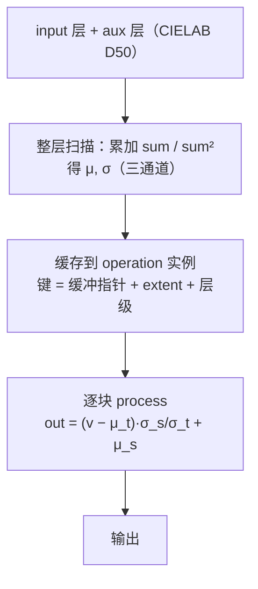

# Match Color（lb:match-color）

经典图像编辑器的「图像 → 调整 → 匹配颜色」的复刻：把**另一张图 / 另一个图层**的
颜色统计量迁移到本层。内核是 Reinhard 等 2001 年提出、经典图像编辑器 沿用至今的
L\*a\*b\* 均值-方差仿射迁移。

## 模型

工作在 CIELAB（D50）里，对 L、a、b 各通道分别做：

```math
\text{out} = \bigl(v-\mu_t\bigr)\cdot\frac{\sigma_s}{\sigma_t} + \mu_s
```



统计量对**整层**计算（经典图像编辑器 亦然），来源是 `aux` pad 接的图层；没接 aux 时
来源退化为本层自身，恒等映射。

## 与 经典图像编辑器的滑杆对应

| 经典图像编辑器 | 这里 | 语义（模型对齐，非逐码标定） |
|---|---|---|
| 亮度 Luminance（1–200，默认 100） | `luminance` | 只缩放 L 的映射量：`k = 滑杆/100`，映射按 `lerp(1, ratio, k)` 收敛。100=精确匹配，200=双倍修正，1=几乎不动 |
| 颜色强度 Color Intensity（默认 100） | `color-intensity` | 同上，只作用于 a/b |
| 渐隐 Fade（0–100） | `fade` | 整体映射量乘 `(1 − fade/100)`；等价 经典图像编辑器的「编辑 → 渐隐」 |
| 中和 Neutralize | `neutralize` | 输出的 a/b 均值强制为 0（去色偏），L 照常；来源仍提供对比度 |

> 经典图像编辑器 2025 的匹配颜色**没有脚本接口**（对话框没有 DOM API，`Mk`/`matchColor`
> 均被拒），拿不到实测基准点，所以这里是模型对齐而非黑盒标定——与色阶的
> 处理方式一致，README 如实声明。

## 全局统计 × 逐块渲染

GEGL 的 process 每次只拿一小块，而均值/方差必须对整层算。做法：

- 首次 `process` 时整层扫一遍 input 与 aux（Lab 域，攒 sum/sum²），缓存在
  operation 实例上（互斥锁保护，键 = 缓冲指针 + extent + 层级）；
- 后续块直接复用缓存，**预览拖滑杆不会反复重算**；
- 来源图层内容变了（非破坏预览场景）勾一次「重算统计 / Refresh stats」，
  重算完自动复位。

## 细则

- **透明像素不进统计**：目标与来源两侧都以 `alpha ≤ 0` 剔除，抠图层的洞
  不会把统计拖向黑（这个坑在应用图像/计算里已经踩过一轮）。
- **σ 保护**：σ < 1e-3 视为常数通道，比值取 1；均匀色来源会把输出均值
  平移到自己的均值色（`(v − μt)` 项本来就是 0）。
- **削顶**：输出 L 削到 [0, 100]、a/b 削到 [−128, 127]，与 经典图像编辑器 在 8bit
  L\*a\*b\* 里工作一致。
- **与「只有相交部分起作用」无关**：匹配颜色不是逐像素混合，来源只捐统计
  量，映射作用于目标整层——这正是 经典图像编辑器的行为。
- 匹配是仿射的，几何不必对齐：来源图层尺寸/偏移随意。

## 验证

```bash
./build.sh
"D:/fastsoftware/GIMP 3/bin/gimp-console-3.2.exe" -i -c -d -f \
    --batch-interpreter=python-fu-eval \
    -b "exec(open(r'<repo>/tools/check_match_color.py').read())" --quit
```

17 项：恒等、均值迁移、方差缩放、亮度/颜色强度滑杆两端、渐隐 50/100、
中和（含输出均值 ≈0 断言）、aux 透明洞不进统计、目标透明像素 alpha 保留、
100 行跨块一致、无 aux 恒等、极端映射不越界。期望值由 Python 镜像模型算出，
Lab 读数直接取自 babl（与算子同一转换路径，不循环论证）。
