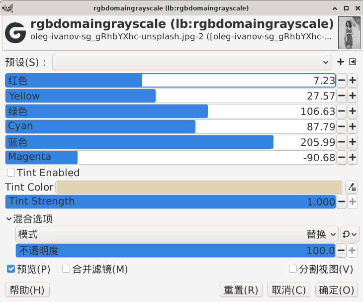

> 本文件是该滤镜的原始说明文档（构建命令按旧目录结构书写，已过时）。
> 统一构建方式请见工程根目录 `README.md` 与 `build.sh`。

# GEGL_GIMP_PLUGIN_rgb-domain-grayscale



## English

### 1. Compile & Install Commands

#### Native Linux (System installed GIMP)

```bash
sh build_linux.sh
cp build/gegl-*.so ~/.local/share/gegl-0.4/plug-ins
```

#### Flatpak Linux (Flatpak GIMP)

```bash
sh build_linux.sh
cp build/gegl-*.so ~/.var/app/org.gimp.GIMP/data/gegl-0.4/plug-ins/
```

### 2. How to Open the Plugin (2 Methods)

After installation, **restart GIMP** to activate the plugin.

#### Method 1: Menu Bar (Recommended)

Menu path: `Colors → SuperMrWang → Tone → Black & White`

#### Method 2: GEGL Operation

1. Go to `Filters → Generic → GEGL Operations`
2. In the search box, enter: `lb:rgb-domain-grayscale`
3. Select it and click `OK` to apply

---

## 中文

### 1. 编译与安装命令

#### Linux 原生版（系统包安装的GIMP）

```bash
sh build_linux.sh
cp build/gegl-*.so ~/.local/share/gegl-0.4/plug-ins
```

#### Linux Flatpak 容器版（应用商店Flatpak GIMP）

```bash
sh build_linux.sh
cp build/gegl-*.so ~/.var/app/org.gimp.GIMP/data/gegl-0.4/plug-ins/
```

### 2. 插件打开方式（两种方法）

安装完成后**重启 GIMP**，插件即可使用。

#### 方法一：菜单打开（推荐）

菜单路径：`颜色 → SuperMrWang → Tone → Black & White`

#### 方法二：GEGL 操作打开

1. 顶部菜单点击：`滤镜 → 通用 → GEGL 操作`
2. 在弹出窗口的搜索框输入：`lb:rgb-domain-grayscale`
3. 选中后点击「确定」即可使用插件

---

## 算法

六个色相滑杆（红 / 黄 / 绿 / 青 / 蓝 / 品红）决定每种颜色对灰度的贡献，
结果还可以着色——就是 经典图像编辑器的「黑白」对话框：把蓝拉低压暗天空，把黄推高提亮肤色，
其余部分不受影响。

RGB 三通道按六色权重加权求和；滑块量程 −200…300 与 经典图像编辑器 界面一致，默认值
（红 40、黄 60、绿 40、青 60、蓝 20、品红 80）取自 经典图像编辑器。

## 参数

| 参数 | 默认 | 说明 |
|---|---|---|
| `red` / `yellow` / `green` | 40 / 60 / 40 | 各色系的权重，−200…300 |
| `cyan` / `blue` / `magenta` | 60 / 20 / 80 | 各色系的权重，−200…300 |
| `tint_enabled` | 关 | 给灰度结果着色 |
| `tint_color` | `#E0D4B2` | 着色颜色（默认是暖棕） |
| `tint_strength` | 1 | 着色强度，0…1 |

## 说明

- 逐像素在 8 位 sRGB 伽马域计算，滑块手感与 经典图像编辑器 对话框一致。
- alpha 保留，透明像素仍然透明。
- 与 GIMP 的「去色」不同：这里的灰度不是固定亮度公式，每种颜色变成什么由你决定，
  这正是「黑白」的用处。

---

## 算法

六个色相滑杆（红 / 黄 / 绿 / 青 / 蓝 / 品红）决定每种颜色对灰度的贡献，
结果还可以着色——就是 经典图像编辑器的「黑白」对话框：把蓝拉低压暗天空，把黄推高提亮肤色，
其余部分不受影响。

RGB 三通道按六色权重加权求和；滑块量程 −200…300 与 经典图像编辑器 界面一致，默认值
（红 40、黄 60、绿 40、青 60、蓝 20、品红 80）取自 经典图像编辑器。

## 参数

| 参数 | 默认 | 说明 |
|---|---|---|
| `red` / `yellow` / `green` | 40 / 60 / 40 | 各色系的权重，−200…300 |
| `cyan` / `blue` / `magenta` | 60 / 20 / 80 | 各色系的权重，−200…300 |
| `tint_enabled` | 关 | 给灰度结果着色 |
| `tint_color` | `#E0D4B2` | 着色颜色（默认是暖棕） |
| `tint_strength` | 1 | 着色强度，0…1 |

## 说明

- 逐像素在 8 位 sRGB 伽马域计算，滑块手感与 经典图像编辑器 对话框一致。
- alpha 保留，透明像素仍然透明。
- 与 GIMP 的「去色」不同：这里的灰度不是固定亮度公式，每种颜色变成什么由你决定，
  这正是「黑白」的用处。
