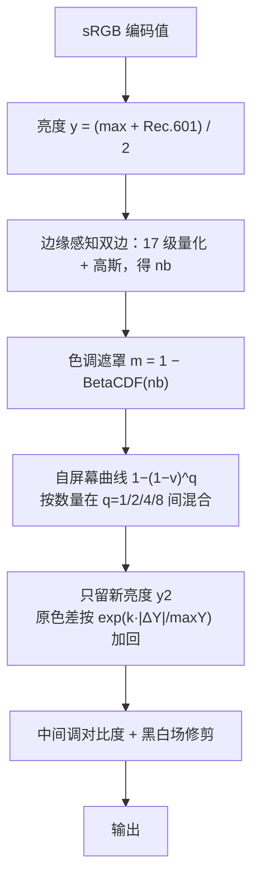

# lb:shadows-highlights · Shadows/Highlights (the classic editor)

> **不推荐日常使用（2026-11-15，性能原因）**　算子仍然可用、数值也仍然准确，
> 但它是空间域算法：半径 30 时每像素约 1.4 µs，2048×1536 默认参数净耗时 0.7 s
> （含解码 2.1 s），在 GIMP 里拖一次滑杆就重算整图。整体明暗请用 `lb:levels` /
> `lb:lab-levels` / `lb:exposure`；确实需要「周围亮就少提」的局部行为再用它，
> 半径压到 10–15 会快很多。标记文件：`ops/shadows-highlights/.discouraged`
> （只影响文档与站点展示，**不影响编译和发布**）。

按黑盒标定得到的 经典图像编辑器的「图像 → 调整 → 阴影/高光」。和另外十几个算子的最大
区别是**它看邻域**：同样一个 128 的像素，周围暗就多提、周围亮就少提，所以不可能简化
成一条 LUT，必须做空间域滤波。

- GEGL id：`lb:shadows-highlights`
- 菜单：`Colors → SuperMrWang → Tone → Shadows/Highlights`
- 类型：`GeglOperationFilter`（空间域，按 192 行一条带处理）
- 参数（默认值照抄 经典图像编辑器）：阴影 `amount 35 / width 50 / radius 30`、高光 `0 / 50 / 30`、
  `color-correction 20`、`midtone-contrast 0`、`black-clip 0.01`、`white-clip 0.01`

## 先记一个坑：经典图像编辑器的脚本入口不叫 Shadow/Highlight

想把经典图像编辑器当 oracle，第一步是能用脚本调起它。`Shdw`、`ShHl`、`shadowsHighlights`、
`shadowHighlight`、`adaptCorrectTones` … 13 个 charID 加 8 个 stringID 轮流试，
全部报「命令<未知的>当前不可用」，`编辑器进程` 和 `Required/*.dll` 里也搜不到
`shadowsHighlights` 字样。

真正的入口是 **`adaptCorrect`**，类名 `adaptCorrectTones`：

```javascript
var d = new ActionDescriptor();
d.putObject(s2t("shadowMode"),    s2t("adaptCorrectTones"), tones(sh));
d.putObject(s2t("highlightMode"), s2t("adaptCorrectTones"), tones(hi));
d.putDouble (s2t("blackClip"), 0.01);
d.putDouble (s2t("whiteClip"), 0.01);
d.putInteger(s2t("colorCorrection"), 20);
executeAction(s2t("adaptCorrect"), d, DialogModes.NO);
```

`shadowMode`/`highlightMode` 里再放 `amount`/`width`/`radius`（`#Prc`），其余键都是
stringID 小写。这条线索来自 官方用户社区一个 Clean SL 脚本，比盲试 ID 快得多。

## 算法结构

六个阶段，数全部来自经典图像编辑器25.4 的黑盒拟合（同一结构见 PhotoCraft，MIT）：

1. **亮度**：最大通道与 Rec.601 亮度的平均，直接作用在 **sRGB 编码值**上
   （不是线性光）。这解释了为什么暗部提亮后颜色会发灰——它动的是显示值：

```math
y = \tfrac{1}{2}\bigl(\max(R,G,B) + 0.299R + 0.587G + 0.114B\bigr)
```
2. **邻域亮度** 边缘感知双边，Durand–Dorsey 的分段线性形式：
   - 先把 `lum` 按 σ=1.3559 轻模糊成 `guide`（只为了抗噪，不决定尺度）；
   - 像素按 `guide` 量化到 **17 级**，每级用权重 `w = 1 − |lum − g|/1.0152` 单独加权平均；
   - 权重和 / 加权和在 `d = ⌊σ/4⌋` 的格子上先累加，再用 **σ = 1.1424·radius** 的高斯模糊；
   - 最后按 `guide` 的小数级在相邻两级间插值，双线性上采样回全分辨率。

   这么做等价于「只和亮度相近的邻居平均」，所以边缘两侧各算各的，不会互相污染。
3. **色调遮罩** 把 nb 当自变量查 256 项表，表 = `1 − BetaCDF(level)`。形状随
   「色调宽度」在 Beta(a,b) 之间线性插值：宽度 0 → Beta(1.95, 23)（只有最暗一小段），
   宽度 ≥95 → `1 − L`（全线）。高光用 `255 − nb` 的镜像。
4. **曲线** 自屏幕 $c_q(v) = 1-(1-v)^q$，$q \in \{1,2,4,8\}$ 按「数量」$A$ 混合：

```math
u = \left(\frac{A}{100}\right)^{0.6216},\qquad
s = \begin{cases}
u/0.3, & u \le 0.3 \\[4pt]
(1+20u)/7, & u > 0.3
\end{cases}
\qquad\Longrightarrow\qquad A = 15 \approx 1,\ 50 \approx 2,\ 100 \approx 3
```

   阴影把每个通道抬 $m\cdot s\,\bigl(c_q(y)-y\bigr)$，高光用镜像压回。
5. **颜色** 只保留结果的新亮度 `y2`；色差取**原像素** `q` 与它自己亮度 `y1` 之差，
   按 `exp(k·|ΔY|/maxY)`（负值 `1 + k·|ΔY|/maxY`）缩放后加回，并统一收进色域。
6. **中间调对比度** 亮度上的全局 S 曲线 `y + k(y−0.5)(4y(1−y))^p`，支点恰在 0.5；
   **修剪黑/白** 是直方图两端的**拉伸**。



五、六两步写成式子：

```math
\text{out}_{ch} = y_2 + (q_{ch}-y_1)\cdot
\begin{cases}
\exp\!\bigl(k\,|\Delta Y|/\max Y\bigr), & \Delta Y \ge 0 \\[6pt]
1 + k\,|\Delta Y|/\max Y, & \Delta Y < 0
\end{cases}
\qquad
y'' = y_2 + k\,(y_2-0.5)\bigl(4y_2(1-y_2)\bigr)^p
```

## 两个反直觉的实测结论

**默认的 0.01% 修剪真的会改变画面。** 一开始用 16 条灰带（16…240）做探针，
首尾两条总被拉到 0/255，误以为是算子串色。实际是 `blackClip`/`whiteClip` 的百分比
是**相对直方图**的：探针没覆盖 0 和 255，0.01% 就把最暗那条当成黑场拉下去了。
换成覆盖 0 与 255 的 129 条 ramp 后假象消失；对照组 `a100/clip0` vs `a100/clip01`
上黑块 0 vs 7、背景 91 vs 87，差得很清楚。

**半径改的不是模糊宽度，是「邻域里亮像素的占比」。** 阶跃边（左 12 右 240）上，
半径从 0 加到 100，远离边缘的平台值单调 73 → 65，而紧贴亮边的那个像素一直是 48–50。
这说明边缘感知权重把亮邻居的贡献压到 ~12%，所以过渡只有 1–2 像素宽；半径变大只是
把更多亮像素拉进窗口，缓慢抬高 nb。用纯高斯直觉去调 σ 是调不对的。

## 性能

平场部分只有 256 项查表，开销全在邻域：17 级 × 4 次高斯。用 192 行条带限制内存，
`ramp-2.png`（25800×160，129 条带）3.2 s，`grid-b016.png`（2560×2560）4.7 s，
都是含 PNG 编解码的墙钟时间。半径 30 时每像素约 1.4 µs。

## 验收

`python tools/check_shadows_highlights.py`（`--fast` 跳过经典图像编辑器对照）：

**一、独立 Python 参考实现 vs 算子**（平场，nb = 自身）。参考实现照上面六步直写，
不复用 C 代码，只共用拟合出来的系数表：

| 检查 | 组数 | 最大偏差 |
|---|---|---|
| 灰阶平场 LUT | 6 组 × 29 级 | **0.0 码**（逐点完全一致） |
| 彩色平场（color-correction +100…−100） | 4 组 × 6 色 | **0.0 码** |
| amount=0 恒等 / 平场与半径无关 | 2 项 | **0.0 码** |
| 中间调支点 128、默认修剪保留 0 与 255 | 2 项 | 通过 |

写这个脚本时抓到过一个真 bug：两个修剪都设 0 时 `clip_lo/clip_hi` 没初始化，
`(y−0)/(0−0)` 把整图推成纯白。现在 `prepare()` 里复位成 0/1，除法也加了兜底。

**二、和经典图像编辑器本身**（`shadows-highlights-cal/`）：

| 数据集 | 规模 | 逐点中位 | 最大 |
|---|---|---|---|
| 平场竖带（17 组参数） | 17×129 | 0.5 码 | **5.7 码**（`h_a100_w0`） |
| 二维格点（14 组背景） | 14×256 | 1.0 码 | **11.1 码**（`grid_h_b240`） |

平场是强项：14/17 组最大 ≤3 码，阴影侧一律 ≤2.6 码。二维格点里 9 组最大 ≤7 码，
中位 1.0。

## 已知偏差

1. **极端局部对比的二维格点**（20×20 小块压在 99% 面积的极端背景上，
   `bg=16` 配亮块、`bg=240` 配暗块）最大差 11 码。平场对得上、只有这种「邻域和
   像素值差 200 码以上」的合成图案对不上，说明邻域核的边缘保持强度还差一点：
   实测 经典图像编辑器的 nb 比本算子更贴近像素自身。把 `SH_RANGE` 从 1.0152 往下调（边缘保持
   更强）会让 87% 的点变好但制造出 87 码的爆点；往上调（4.0 / 50，趋近纯高斯）
   则单调变差。1.0152 是实测的局部最优值，所以保持原样，这个尾巴留着。
2. **`h_a100_w0` 的 5.7 码**：色调宽度 0 时遮罩退化成 Beta(1.95, 23) 在最暗一段的
   陡壁，插值表按宽度每 5 一档建，宽度 0 正好落在第一个节点上，误差最敏感。
3. **半径 > 300 没标定**：经典图像编辑器 对话框上限 2500，标定只做到 300，更大半径按同一
   σ=1.1424·r 外推。
4. `midtone_contrast` 与 `color_correction` 用的是参考实现的拟合系数，**没有单独做
  经典图像编辑器实测**（平场和彩色平场只验证了算子与参考实现一致，不是与经典图像编辑器一致）。

## 复现标定

`shadows-highlights-cal/` 里有全套脚本：`apply_cases.jsx`（经典图像编辑器 侧执行器）、
`run_cases.py`（批量跑 + 读结果）、`make_ramp.py` / `make_grid.py`（三套探针：
灰阶竖带、二维格点、阶跃边）、`compare_op.py`（逐点比对）、`dump_grid.py` /
`analyze_nb.py`（单例残差与邻域反推）、`sweep.py`（邻域尺度扫参）。

---

## 性能（2026-11-12 重构）

卡顿的三个根因，全部修掉：

1. **GEGL 按列并行，margin 随调用次数线性重复**。3M 像素被拆成 12 根 171 宽的
   竖条同时跑，每根竖条各带完整的水平 margin——r30 重复 2.4×，r300（margin
   1277 px）重复 **17×**。修复：整个 extent 的邻域亮度**只算一次**，缓存成
   8 位层级平面（遮罩查表用 `lv = lround(clamp(nb)·255)`，8 位量化无损），
   各列直接采样。缓存在参数变化（prepare 比较）、输入内容变化（24 行整行
   哈希指纹，能察觉下层涂改）、几何变化三种情况下失效。
2. **黑/白修剪的预扫把整条管线跑两遍**。默认 0.01/0.01 就触发。缓存路径下
   预扫改用现成的层级平面，只剩轻量逐像素。
3. **逐行 `gegl_buffer_set`**。每条 192 行调 192 次写；改为整条/整 ROI 一次写。

实测（2048×1536，含 PNG 解码 ~1.3s）：默认参数 3.7s → 2.1s；r300 9.8s → 2.1s
（净耗时 7.9s → 0.7s，**~11×**）。数值与旧实现**逐位一致**（4 组极端参数下
缓存路径 = 回退路径 = 旧实现三方对拍）。

超大图或 margin 超预算（`SH_CACHE_MAXPX` 20MP / `SH_CACHE_BUDGET`）自动回落
到按条带就地计算；`SH_NO_CACHE=1` 环境变量可强制走回退路径（调试用）。
条带高度按 margin 自适应（`4×margin`，192–1024 行），亮度取数分块
（≈32MB/块）控峰值内存。
