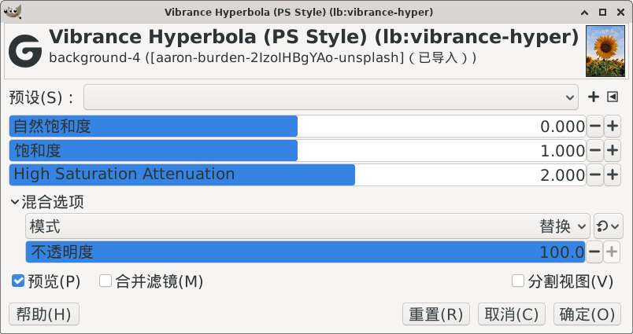

> 本文件是该滤镜的原始说明文档（构建命令按旧目录结构书写，已过时）。
> 统一构建方式请见工程根目录 `README.md` 与 `build.sh`。

# GEGL_GIMP_PLUGIN_vibrance-hyper



## English

### 1. Compile & Install Commands

#### Native Linux (System installed GIMP)

```bash
sh build_linux.sh
cp build/gegl-*.so ~/.local/share/gegl-0.4/plug-ins
```

#### Flatpak Linux (Flatpak GIMP)

```bash
sh build_linux.sh
cp build/gegl-*.so ~/.var/app/org.gimp.GIMP/data/gegl-0.4/plug-ins/
```

### 2. How to Open the Plugin (2 Methods)

After installation, **restart GIMP** to activate the plugin.

#### Method 1: Menu Bar (Recommended)

Menu path: `Colors → SuperMrWang → Vibrance`

#### Method 2: GEGL Operation

1. Go to `Filters → Generic → GEGL Operations`
2. In the search box, enter: `lb:vibrance-hyper`
3. Select it and click `OK` to apply

---

## 中文

### 1. 编译与安装命令

#### Linux 原生版（系统包安装的GIMP）

```bash
sh build_linux.sh
cp build/gegl-*.so ~/.local/share/gegl-0.4/plug-ins
```

#### Linux Flatpak 容器版（应用商店Flatpak GIMP）

```bash
sh build_linux.sh
cp build/gegl-*.so ~/.var/app/org.gimp.GIMP/data/gegl-0.4/plug-ins/
```

### 2. 插件打开方式（两种方法）

安装完成后**重启 GIMP**，插件即可使用。

#### 方法一：菜单打开（推荐）

菜单路径：`颜色 → SuperMrWang → Vibrance`

#### 方法二：GEGL 操作打开

1. 顶部菜单点击：`滤镜 → 通用 → GEGL 操作`
2. 在弹出窗口的搜索框输入：`lb:vibrance-hyper`
3. 选中后点击「确定」即可使用插件

---

## 算法说明（2026-11 重写）

在 LAB（D65）空间处理，工作于线性 sRGB，自动跟随输入色彩空间。

**蒙版结构** `M = M_chroma(C*) × M_skin(h) × M_gamut`

- `M_chroma = 1/(1 + atten·(C*/50)^1.3)`：读**源图**色度 C*，色度越高增益越低；
  指数 1.3 让 C*>60 掉得比纯双曲线更快。与 Saturation 滑杆互不影响。
- `M_skin`：LAB 色相 55° 附近（橙/肤色带）、色度 8–80 区间时降权，
  用 smoothstep 软窗，边界无硬边。强度由 `Skin Protection`（默认 0.7）控制，0 = 关闭。
- `M_gamut`：色度沿**原色相、原明度**放大后，若超出 sRGB 色域，按 5 步二分收敛
  到色域边界内的最大值。色相与明度恒不变，替代逐通道硬裁剪（硬裁剪会扭色相）。

`vibrance` 滑杆（±50 UI 范围）等效于低饱和区 C* 的最大 ×2（+50）/ ×3（+100）放大；
全局 `Saturation` 是独立的线性色度乘法，与蒙版无关。

实测（10 个标准色块，vibrance=+50）：色相偏移 ≤0.7°（旧版最高 10.2°）；
肤色增幅 1.16–1.18×（旧版 1.47–1.55×）；低饱和区 1.76–2.00×。
vibrance=0 且 saturation=1 时输出与输入逐字节一致。
