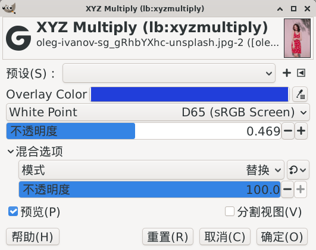

> 本文件是该滤镜的原始说明文档（构建命令按旧目录结构书写，已过时）。
> 统一构建方式请见工程根目录 `README.md` 与 `build.sh`。

## 这个算子就是 经典图像编辑器的「照片滤镜」/ This is 经典图像编辑器's Photo Filter

经典图像编辑器的照片滤镜（`滤镜 → 调整 → 照片滤镜`）内部等价于「纯色填充 + 正片叠底 +
密度」，本算子按实测把整条链路复刻出来。参数一一对应：

| 经典图像编辑器 照片滤镜 | `lb:xyz-multiply` | 说明 |
|---|---|---|
| 滤镜（Filter）颜色 | `overlay_color` | 经典图像编辑器的 20 多个预设只是快捷方式，本质仍是颜色 |
| 密度（Density）0–100% | `opacity` 0–1 | 除以 100 |
| 保留明度（Preserve Luminosity） | `preserve_luminosity` | **默认开**，与 经典图像编辑器 出厂设置一致 |
| —（经典图像编辑器 没有） | `white_mode` | 参照白点，**默认 D50**（经典图像编辑器的 Lab 白点） |

### 算法（实测反推，不是猜的）

1. sRGB 线性化，用**标准 Bradford**（锥响应矩阵，不是适配矩阵本身）转到 D50 XYZ；
2. 逐通道乘 `k = (1-d) + d · (滤镜色XYZ / D50白点)`，`d` = 密度；
3. 转回编码值；若开保留明度，再做 **W3C / PDF 的 SetLum + ClipColor**
   （编码值上、Rec.601 权重 0.3/0.59/0.11）。

前两步在线性 sRGB 里等价于一个常数 3×3 矩阵
`M = XYZ2sRGB · A⁻¹ · diag(k) · A · sRGB2XYZ`，每 process 只算一次。

判据（都能在 `photo-filter-cal/` 里复现）：

- 纯红、密度 50% 时 128 灰 → G 通道 **92**。线性光乘给 92.6，编码域乘只会给 64。
- 纯红、密度 100%、保留明度时 128 灰 → **(218, 90, 90)**，SetLum 手算恰是
  (217.6, 89.6, 89.6)；换成 Lab 保 L\*、乘性还原、Rec.709 权重都对不上（中位差 5～45 码）。
- 反推的滤镜色 XYZ (0.453, 0.222, 0.0166) 与「纯红转到 D50 再除以 D50 白点」
  (0.4522, 0.2225, 0.0169) 差不到 1%；按 D65 归一化则差 4.4% —— 所以是 D50。

### 实测精度（经典图像编辑器 2025）

| 组 | 档数 | 最大差 | 中位差 |
|---|---|---|---|
| 灰阶 256 级，不保留明度 | 9 | **0.71 码** | 0.12–0.40 码 |
| 灰阶 256 级，保留明度 | 3 | 1.86 码 | 0.26–0.42 码 |
| 彩色 64×64，不保留明度 | 3 | **0.65 码** | 0.35–0.39 码 |
| 彩色 64×64，保留明度 | 3 | 5.65 码 | 0.56–0.69 码 |

保留明度档的大误差只出现在裁剪边界（整幅彩色图 12288 个通道值里 55～96 个），
是 经典图像编辑器的取整顺序与 W3C 参考实现不同造成的，非边界点的中位差在 0.7 码以内。

复现链：

```bash
python photo-filter-cal/make_probe.py        # 256×16 灰阶探针（嵌 sRGB ICC）
# 经典图像编辑器 里跑 photo-filter-cal/batch_pf.jsx      # 12 档灰阶
# 经典图像编辑器 里跑 photo-filter-cal/batch_pf_color.jsx # 6 档彩色
python photo-filter-cal/model_pf.py         # 模型 vs 经典图像编辑器
python tools/check_photo_filter.py          # 算子 vs 经典图像编辑器（端到端）
python tools/check_xyz_multiply.py --all    # 算子 vs 独立参考实现
```

# GEGL_GIMP_PLUGIN_xyzmultiply



## English

### 1. Compile & Install Commands

#### Native Linux (System installed GIMP)

```bash
sh build_linux.sh
cp build/gegl-*.so ~/.local/share/gegl-0.4/plug-ins
```

#### Flatpak Linux (Flatpak GIMP)

```bash
sh build_linux.sh
cp build/gegl-*.so ~/.var/app/org.gimp.GIMP/data/gegl-0.4/plug-ins/
```

### 2. How to Open the Plugin (2 Methods)

After installation, **restart GIMP** to activate the plugin.

#### Method 1: Menu Bar (Recommended)

Menu path: `Colors → SuperMrWang → Blend → XYZ Multiply`

#### Method 2: GEGL Operation

1. Go to `Filters → Generic → GEGL Operations`
2. In the search box, enter: `lb:xyz-multiply`
3. Select it and click `OK` to apply

---

## 中文

### 1. 编译与安装命令

#### Linux 原生版（系统包安装的GIMP）

```bash
sh build_linux.sh
cp build/gegl-*.so ~/.local/share/gegl-0.4/plug-ins
```

#### Linux Flatpak 容器版（应用商店Flatpak GIMP）

```bash
sh build_linux.sh
cp build/gegl-*.so ~/.var/app/org.gimp.GIMP/data/gegl-0.4/plug-ins/
```

### 2. 插件打开方式（两种方法）

安装完成后**重启 GIMP**，插件即可使用。

#### 方法一：菜单打开（推荐）

菜单路径：`颜色 → SuperMrWang → Blend → XYZ Multiply`

#### 方法二：GEGL 操作打开

1. 顶部菜单点击：`滤镜 → 通用 → GEGL 操作`
2. 在弹出窗口的搜索框输入：`lb:xyz-multiply`
3. 选中后点击「确定」即可使用插件
