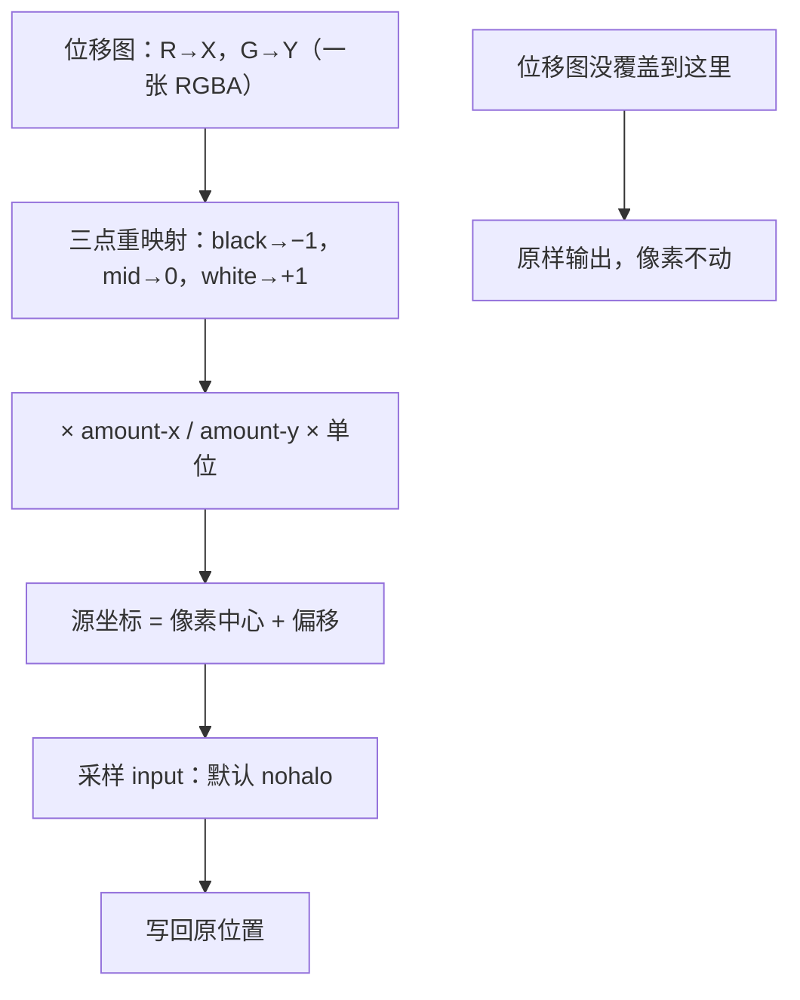

置换（Displace）是那种「一天用不上一次，用上就离不开」的滤镜：水面倒影、玻璃折射、
布料褶皱、地形贴图，全靠它。GIMP 里现成有 `gegl:displace`，能出结果，但每次用它都得
绕着走——你得先猜它为什么不按你想的方向动，再去猜它为什么在某个角落整块跳了一下。

问题不在实现质量，在那个算子的**性格**被一行公式写死了：

```math
\Delta = 2 \cdot \text{amount} \cdot (Y' - 0.5) \cdot \alpha
```

`Y'` 是位移图的亮度，`α` 是位移图的 alpha。就这一行，决定了它全部的形状。

## 一、位移图为什么必须「中性」

中点是 0.5，意味着位移图必须是**中性灰**才不会动。这听起来合理，直到你意识到：
一张在 GIMP 里随手画的灰度图、一个从别的软件导出的置换贴图，白场往往在 1.0、
黑场在 0.0，而你以为的「不动」——如果你的图是 0–1 全黑到全白，等于整张图被
`amount` 推着走，中间没有停顿点。

更麻烦的是它把位移**和亮度绑死**。你想让一片区域向右 20 像素、向下 5 像素，
就得准备两张对齐的灰度图：一张编码 X，一张编码 Y。两张图只要有一像素的错位，
结果就是一片糊。

## 二、透明处会**静默**失效

这是最阴的一条。`gegl:displace` 的 aux 格式是 `Y'A float`，`α` 直接乘进位移量。
于是：拿一个带透明背景的图层当位移图，透明的地方位移恒等于 0——不报错，不警告，
画面上就是那一块没动。

配上它的 aux iterator 用的是 `GEGL_ABYSS_NONE`，位移图没覆盖到的区域读出来是 0，
于是那里不是「不动」，而是被**整块硬移** `−amount`。两个坑叠在一起，症状是：
画布边缘出现一条莫名其妙的错位，而你怎么调位移图都没用。

## 三、单位只有像素

像素作为单位没错，错在它是**唯一**的。1000 px 宽的图上 `amount=20` 是 2% 的位移，
看起来刚好；同一套参数搬到 4000 px 的图上，同一张图缩放后重跑，效果只剩四分之一。
想保持视觉一致，就得每次手工换算。

## 四、重采样默认双三次

高对比边缘在双三次插值下会振铃——边缘外侧出现一圈亮边。位移滤镜本来就在「造边」，
振铃会被放大成肉眼可见的假轮廓。

---

## 我们的做法

`lb:displace` 把这四件事拆成四个参数，默认值按「最不容易踩坑」定。



**一张图给两轴。** 矢量场模式下 R 通道给水平、G 通道给垂直，0 是「不动」。
再也不用对齐两张图。需要老式的「一张灰度图 + 两个比例」时，切到单通道模式即可。

**三点重映射。** `black-point` / `midpoint` / `white-point` 三个点一起决定映射曲线，
中点两侧各自线性归一到 −1..+1。`0 / 0.5 / 1` 是标准灰图，`−1 / 0 / 1` 是零中性
矢量场（R=0 就是不动），`0.2 / 0.4 / 0.6` 等于先把位移图加对比度再用。超量程不截断，
最多允许超出 ±8 倍，方便做「少数像素位移特别大」的效果。

**单位可换成百分比。** `Percent of long edge` 下，`amount=2` 表示长边的 2%——换分辨率
不用重调参数，这是批量处理里最省事的一档。

**没覆盖的区域原样输出。** 位移图的 extent 之外，像素原封不动地写回去。这条看起来
是细节，实际决定了「用一张小图当局部置换」能不能用。

**默认 nohalo。** 五种采样器都在（最近邻 / 双线性 / 双三次 / nohalo / lohalo），
默认挑不振铃的那个。五种越界策略：环绕、重复边缘、透明、黑、白。

## 一个容易忽略的坑：画布不能变形

GEGL 的 composer 默认把 bounding box 取成 input 与 aux 的并集。位移图如果带偏移
（比如你把它放在了 (40, 0)），那个偏移会把整个画布撑大——4×4 的图出成 6×4。

所以 `get_bounding_box` 必须显式覆盖成输入的范围。这条对 composer 类是通例：
**只要 aux 的位置不该影响输出尺寸，就得自己写 bbox。** 同一批里四个邻域算子
（锐化、两个降噪、蒙尘）也踩了同一个坑，只不过方向相反：area filter 默认按 pad
外扩，8×8 会输出 22×22，同样得覆盖成输入尺寸。

## 自检

`python tools/check_displace.py` 11 项，逐条对着上面四个「拧开的旋钮」：

- 零位移时逐位恒等（包括带 alpha 的图）
- 一张 RGBA 图能同时驱动两轴；单通道模式与「灰度图 + 两个比例」等价
- `alpha-weight` 打开时复刻 `gegl:displace` 的行为（用来证明默认值确实不同）
- 位移图未覆盖区原样输出，边缘不出现硬移
- 三种单位换算一致；`black / mid / white` 压缩后线性度正确
- 输出尺寸等于输入尺寸（bbox 没被位移图撑大）

想直接用：`SuperMrWang → Distort → Displace`，或者 `lb:displace` 挂成图层上的
非破坏滤镜，滑杆拖起来看。
