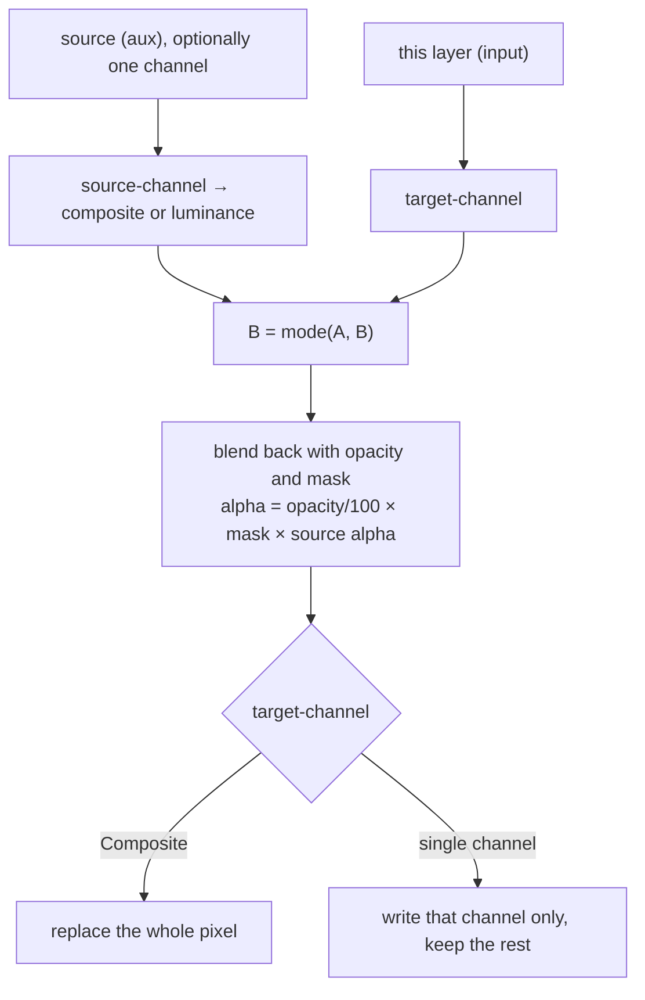

`lb:apply-image` · menu **Colors → SuperMrWang → Blend → Apply Image** · two inputs (input + aux)

Replicates the classic editor's **Image → Apply Image**: a second image (another layer, another
file) acts as the source and is blended onto the current layer with a blend mode,
opacity and mask — optionally into one channel only.

## Parameters

| Parameter | Default | Notes |
|---|---|---|
| `blend-mode` | Multiply | 26 modes, in the classic editor's order (Normal … Divide, Darker/Lighter Color, Hue … Luminosity) |
| `opacity` | 100 | Blend strength: 0 leaves the target alone, 100 applies it fully |
| `target-channel` | Composite | Where the result goes: the whole composite, or a single R/G/B/luminance/alpha |
| `source-channel` | Composite | Which channel of aux is read as the source |
| `mask-enabled` | no | Use another channel as a mask |
| `mask-from` | Source layer | Take the mask from aux or from this layer |
| `mask-channel` | Composite | Mask channel (Composite takes luminance) |
| `invert-mask` | no | Invert the mask |
| `preserve-transparency` | no | Leave fully transparent pixels untouched (the classic editor's "Preserve Transparency") |
| `output-mode` | Composite | Composite result / grey mask / alpha mask |

## How it maps to the classic editor

| the classic editor | Here |
|---|---|
| Source: image + layer | the `aux` pad, picked in the filter dialog |
| Source: channel | `source-channel` |
| Target: channel | `target-channel` |
| Blending / Opacity | `blend-mode` / `opacity` |
| Preserve Transparency | `preserve-transparency` |
| Mask: layer + channel + invert | `mask-from` + `mask-channel` + `invert-mask` |

the classic editor's mask may point at a *third* image — neither the target nor the source.
A GEGL composer only exposes two inputs, so the mask is limited to "this layer" or
"the source layer", which covers the overwhelming majority of real use.

## Algorithm



```math
\text{out} = (1-\alpha)\,A + \alpha\,B_{\text{mode}}(A,B),\qquad
\alpha = \frac{\text{opacity}}{100}\cdot m\cdot\alpha_{\text{src}}
```

```math
\text{add/sub:}\quad \text{out} = \operatorname{clamp}\!\left(\frac{A \pm B}{\text{scale}} + \frac{\text{offset}}{255},\ 0,\ 1\right)
```

## Behaviour notes

- **With no aux connected** the source falls back to the input itself, which is
  useful for mixing channels inside one image.
- **Transparent source pixels (alpha = 0) take no part.** On a cut-out, text layer
  or any layer with a transparent background the holes hold RGB 0, and blending
  them normally would multiply the target to black. The alpha doubles as coverage,
  so a soft matte fades out instead of leaving a hard edge.
- With a single-channel target only that channel changes and the rest is preserved;
  a composite source is reduced to luminance.
- Darker / Lighter Color compare whole-pixel luminance and then take **all**
  channels of the winner, not per-channel min/max — that is what separates them
  from Darken / Lighten.
- Everything runs in the 8-bit sRGB gamma domain, the same domain the classic editor's blend
  modes are defined in; the result is clipped to 0..1.
- In GIMP these aux-carrying filters can currently only be applied destructively —
  they cannot be stored as a non-destructive fx.

```bash
./build.sh              # also builds build/auxrun, the two-input runner
```

## Source layer size and position

the classic editor requires both layers to have exactly the same pixel size and greys the
source out otherwise. GIMP layers may be smaller than the canvas or carry an offset,
so the rule here is two-stage:

- the operator uses the `aux` buffer's own extent (the source layer's size and
  position) as a **coarse filter** — pixels it does not cover are passed through;
- inside that area the source alpha decides whether a pixel really carries
  anything: alpha = 0 is passed through, and alpha between 0 and 1 attenuates by
  coverage. Only "belongs to the source layer *and* has a pixel" is modified, which
  is what the classic editor means by "only the intersection takes effect".

The earlier version used `GeglOperationPointComposer`, whose `process` only gets a
raw pointer — it cannot see the aux extent, so GEGL padded the outside with
transparent black and it took part in the blend: multiply blackened the outside,
normal erased it. Switching to `GeglOperationComposer` gives `process` a real
`GeglBuffer`, `gegl_buffer_get_extent(aux)` returns the layer size, and
`tools/auxrun` grew `aux-x` / `aux-y` to simulate an offset source layer.

The extent only says "this area belongs to the source layer", not "this area has
pixels" — a cut-out's holes sit inside the extent, and extent-only logic would
still multiply them to black. Both checks are needed.

## Testing

```bash
./build.sh
python tools/check_blend.py     # 26 cases, 19 of them for Apply Image: blend modes, masks,
                                # channels, source size/offset, transparent and semi-transparent
                                # source coverage
```
