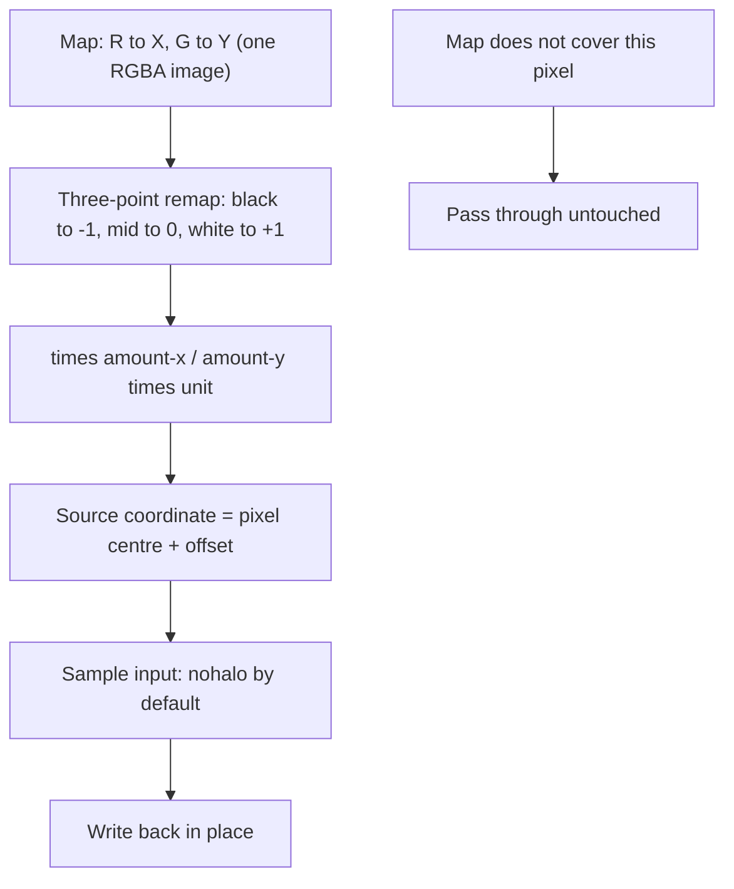

Displacement is the filter you use once a month and cannot live without on that day:
water reflections, glass refraction, cloth folds, terrain textures. GIMP already ships
`gegl:displace`. It produces output, but every use starts with working around it — first
guessing why it moves things in a direction you did not ask for, then guessing why some
corner of the canvas jumped in one block.

The problem is not the quality of the implementation. It is that the operator's whole
character is fixed by one line:

```math
\Delta = 2 \cdot \text{amount} \cdot (Y' - 0.5) \cdot \alpha
```

`Y'` is the map's luminance, `α` its alpha. That line explains everything else.

## 1. Why the map has to be neutral grey

The midpoint is 0.5, so the map must be neutral grey to mean "do not move". That sounds
reasonable until you notice that a greyscale image drawn in a hurry, or a displacement
texture exported from another application, usually spans 0.0 to 1.0 — and if your map
runs black to white, the whole image is being pushed by `amount` with no resting point
anywhere in it.

Worse, displacement is welded to luminance. Moving one region 20 px right and 5 px down
requires *two* perfectly aligned greyscale maps, one encoding X, one encoding Y. A single
pixel of misalignment between them smears the result.

## 2. Transparent areas fail silently

This is the nastiest one. The aux format is `Y'A float`, and `α` is multiplied straight
into the displacement. So a map layer with a transparent background moves nothing wherever
it is transparent: no error, no warning — that area simply does not move.

Together with an aux iterator opened with `GEGL_ABYSS_NONE`, anything outside the map's
extent reads as zero, which does not mean "stay put" but "shift by `-amount`". Stack the
two and the symptom is a mysterious seam along the edge of the canvas that no amount of
map editing will remove.

## 3. Pixels are the only unit

Pixels are a fine unit; being the *only* unit is not. `amount=20` on a 1000 px image is a
2% shift and looks right. Run the same settings on a 4000 px image and the effect is a
quarter as strong. Keeping the look consistent means converting by hand every time.

## 4. Bicubic is the default sampler

High-contrast edges ring under bicubic interpolation — a bright halo just outside the
edge. A displacement filter exists to create edges, so the ringing gets amplified into
visible false contours.

---

## What we did about it

`lb:displace` turns those four items into four parameters, with defaults chosen so that
the least surprising thing happens.



**One image, both axes.** In vector mode the red channel drives X, green drives Y, and
zero means "stay". No more aligning two maps. When you want the classic "one greyscale
image plus two ratios", switch to single-channel mode.

**Three-point remap.** `black-point` / `midpoint` / `white-point` define the transfer
curve; each side of the midpoint is normalised independently onto -1..+1. `0 / 0.5 / 1`
is a plain grey map, `-1 / 0 / 1` is a zero-centred vector field (R = 0 means stay),
`0.2 / 0.4 / 0.6` is "add contrast to the map first, then use it". Out-of-range values
are not clipped — up to eight times over-range is allowed, for the "a few pixels move
very far" looks.

**Percentage units.** Under *Percent of long edge*, `amount=2` means 2% of the long edge.
Changing resolution no longer means retuning, which is what makes batch work bearable.

**Uncovered areas pass through.** Outside the map's extent the input pixel is written back
untouched. That sounds like a detail; in practice it decides whether "use a small image as
a local displacement" is usable at all.

**Nohalo by default.** All five samplers are available (nearest, bilinear, bicubic,
nohalo, lohalo) and the default is the one that does not ring. Five abyss policies too:
wrap, clamp, transparent, black, white.

## An easy-to-miss trap: the canvas must not change size

A GEGL composer takes its bounding box as the union of input and aux by default. If the
map carries an offset — say you placed it at (40, 0) — that offset grows the canvas: a
4×4 image comes out 6×4.

So `get_bounding_box` has to be overridden to return the input extent. This is the general
rule for composers: **whenever the aux position must not affect output size, write your
own bbox.** The same batch of work hit the identical trap, mirrored, on four neighbourhood
operators (sharpening, two denoisers, dust): an area filter expands by its pad by default,
turning 8×8 into 22×22, and needs the same override.

## Self-check

`python tools/check_displace.py` runs 11 assertions, one line per unbolted knob:

- zero displacement is a bit-exact pass-through, alpha included
- one RGBA map drives both axes; single-channel mode matches "greyscale map plus two ratios"
- `alpha-weight` on reproduces `gegl:displace`'s behaviour, proving the default differs
- areas outside the map pass through, with no hard shift at the edges
- the three unit settings convert consistently, and the black / mid / white compression is linear
- output size equals input size, so the map did not inflate the canvas

Try it under `SuperMrWang → Distort → Displace`, or mount `lb:displace` on a layer as a
non-destructive filter and drag the sliders.
