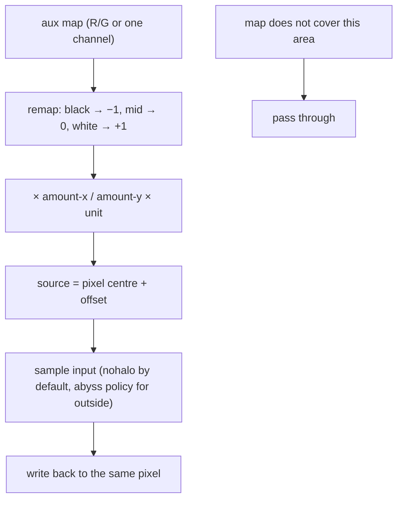

`lb:displace` · menu **SuperMrWang → Distort → Displace** · two inputs (input + aux)

Resamples the image through a displacement map. GEGL's own `gegl:displace` works,
but several of its knobs are welded shut; this one opens them.

## Why not gegl:displace

`gegl:displace` computes `2 × amount × (Y′ − 0.5) × alpha` per pixel, with the map
read as `Y'A float`. That single line defines its whole character:

| | `gegl:displace` | `lb:displace` |
|---|---|---|
| Map is read as | luminance Y′ only; one image **per axis** | vector field R→X, G→Y, **one image** for both axes; single channel mode too |
| alpha | always multiplied, so a transparent part of the map silently cancels the displacement | not multiplied by default; `alpha-weight` turns it on explicitly |
| Rest value | pinned at 0.5 | `midpoint` is adjustable, plus `black-point` / `white-point` for range compression and over-range shifts |
| Unit | pixels | pixels or **percent of the long edge**, so resizing the image does not invalidate the amount |
| Out of bounds | clamp / loop / black / white | same, plus **transparent** |
| Resampling | bicubic by default, which rings into white halos on hard edges | **nohalo** by default, switchable to bilinear / cubic / lohalo |
| Where the map does not reach | reads zero and hard-shifts the area by −amount | **passes through untouched** |
| Output size | follows the input | follows the input (bounding box overridden, so an offset map cannot grow the canvas) |

The first two matter most: with a layer that has transparency as the map,
`gegl:displace` cancels the displacement there without a word, and driving both
axes needs two perfectly aligned greyscale images. One RGBA map does both here.

## Parameters

| Parameter | Default | Notes |
|---|---|---|
| `amount-x` | 0 | Horizontal displacement at the map's white point |
| `amount-y` | 0 | Vertical displacement at the map's white point |
| `units` | Pixels | `Pixels` stays fixed; `Percent of long edge` scales with the image |
| `map-mode` | Vector | `Vector` reads R→X and G→Y; `Single channel` feeds one channel to both axes |
| `map-channel` | Luminance | Which channel single channel mode reads (luminance / R / G / B / A) |
| `black-point` | 0 | Map value meaning −1 × the amount |
| `midpoint` | 0.5 | Map value meaning no displacement. Grey maps use 0.5, zero-centred vector fields use 0 |
| `white-point` | 1 | Map value meaning +1 × the amount |
| `alpha-weight` | no | Multiply the displacement by the map's alpha (reproduces `gegl:displace`) |
| `abyss` | Wrap around | Sampling outside the image: wrap / repeat edge / transparent / black / white |
| `resampling` | Nohalo | nearest / bilinear / bicubic / nohalo / lohalo |

The three mapping points put −1 at black, 0 at the midpoint and +1 at white,
**each side scaled independently**. `0 / 0.5 / 1` is a plain grey map,
`−1 / 0 / 1` is a zero-centred vector field, and `0.2 / 0.4 / 0.6` stretches a
narrow band of the map into the full range.

## Algorithm



```math
t(v)=\begin{cases}\dfrac{v-\text{mid}}{\text{white}-\text{mid}} & v\ge \text{mid}\\[4pt]
\dfrac{v-\text{mid}}{\text{mid}-\text{black}} & v<\text{mid}\end{cases}
\qquad
\text{src}=(x+\tfrac12+t_x A_x u,\; y+\tfrac12+t_y A_y u)
```

`u` is the unit factor (1 for pixels, long edge × 0.01 for percent). Vector mode
uses `t(R)` and `t(G)`; single channel mode feeds one `t` to both axes, so the
ratio of the two amounts picks the direction.

## Recipes

- **Water ripples, heat haze**: use `gegl:perlin-noise` as the map with
  `midpoint=0` (the noise is centred on zero), amounts of 10–30 px,
  `resampling=nohalo`.
- **Seamless tiles**: the map has to be seamless too, and use
  `abyss=Wrap around`; otherwise the seam simply moves somewhere else.
- **Inverse lens distortion**: generate a coordinate field from the reverse of
  `gegl:lens-distortion`. Single channel mode only handles concentric cases;
  anything radial really needs the vector map.
- **Worn type, smearing**: with amounts above ~50 px raise `resampling` to
  `Lohalo` and blur the map slightly first — a hard-edged map samples into
  stair steps.

## Migrating from gegl:displace

Move the two greyscale maps into one RGBA map: R takes the horizontal map, G the
vertical one, both still resting at mid grey. With a single grey map, switch to
single channel mode and put the two old ratios into the two amounts.

## Testing

```bash
python tools/check_displace.py -v
```

Eleven per-pixel assertions: identity at zero amount, full-scale shifts in both
directions, wrap versus clamp, X and Y independent in a vector field, single
channel mode, percent units, over-range white point, a transparent map still
shifting by default, `alpha-weight` freezing the transparent part, and a map
that only covers half the canvas leaving the rest untouched.
