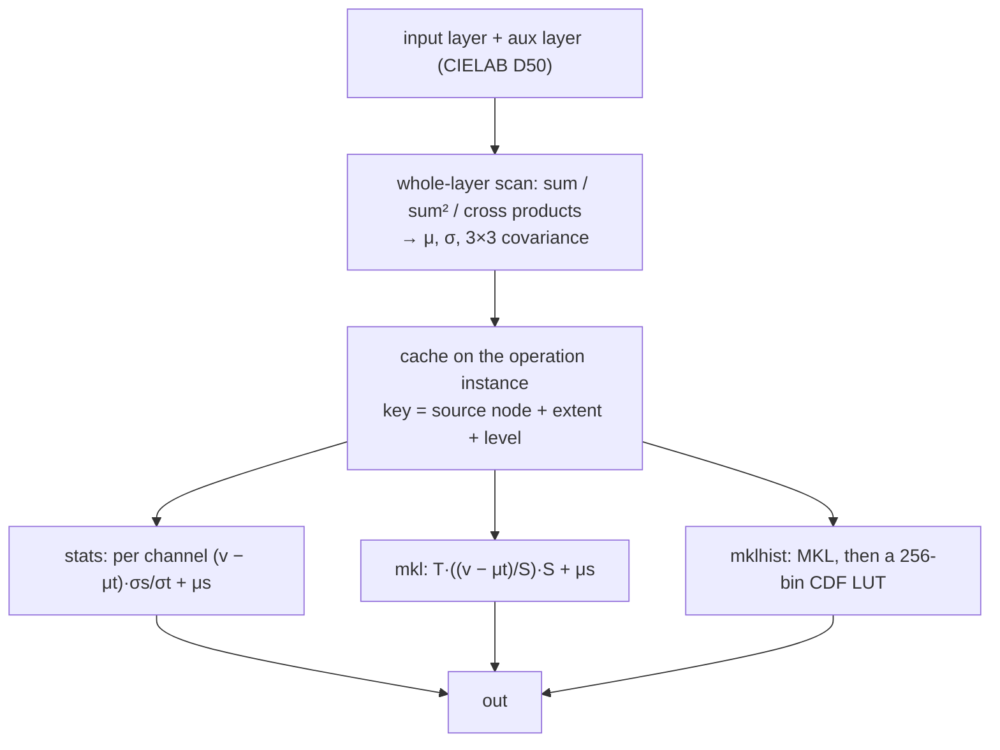

A reproduction of the classic editor's **Image → Adjustments → Match Color**: transfer the
colour statistics of **another image or layer** onto this one. The default *Statistics*
method is exactly what the classic editor does (Reinhard et al.'s 2001 L\*a\*b\*
mean–variance affine transfer); the other two are well-established published algorithms
that behave better, exposed as a `method` dropdown.

## Model

Working in CIELAB (D50), with `method` choosing one of three mappings.

**① Statistics (`stats`, default)** — per-channel mean/std affine, what the classic
editor does:

```math
\text{out} = \bigl(v-\mu_t\bigr)\cdot\frac{\sigma_s}{\sigma_t} + \mu_s
```

**② Monge-Kantorovich (`mkl`)** — treats L, a and b as one 3-D distribution and solves
the linear optimal transport on the full covariance:

```math
\text{out} = T\bigl((v-\mu_t)\oslash S\bigr)\odot S + \mu_s,
\qquad T\,\Sigma_t T^{\mathsf T} = \Sigma_s
```

`S = diag(100, 128, 128)` is the per-channel scale: L's range is more than twice a/b's,
and without normalising, L's variance would swamp chroma and skew the transport metric.
T has a closed form (Pitié & Kokaram, CVMP 2007):

```math
T = \Sigma_t^{-1/2}\left(\Sigma_t^{1/2}\Sigma_s\Sigma_t^{1/2}\right)^{1/2}\Sigma_t^{-1/2}
```

Among all linear maps satisfying `T Σt Tᵀ = Σs` it is the one with the least transport
cost (Wasserstein-2). The difference that matters: per-channel matching implicitly
assumes L, a and b are uncorrelated, while real images correlate them strongly — so
independent scaling tears a single colour apart along one channel and leaves blotches
and holes, which MKL avoids.

**③ MKL + histogram (`mklhist`)** — ② followed by a per-channel CDF match (256-bin
LUT) that pulls the residual onto the donor's histogram. It reaches the tonal tails a
linear map cannot, at the price of replacing more of the original's tonal structure
(and going flat in extreme cases).



| method | statistics needed | relation to the classic editor | when to use it |
|---|---|---|---|
| `stats` | 6 numbers (μ, σ) | **it is its behaviour** | reproducing the classic editor; similar images |
| `mkl` | 6 + 9 (covariance) | more accurate: uses the correlation | heavy re-grading, cross-image transfer, no blotches |
| `mklhist` | the above + two histograms | stronger: moves the tonal distribution too | you want the reference's whole look |

Statistics are computed over the **whole layer** (the classic editor does the same), with the
source coming from the layer wired to the `aux` pad. With no aux connected the source
falls back to this layer itself, i.e. an identity map.

## Mapping to the classic editor's sliders

| the classic editor | Here | Semantics (model-aligned, not code-calibrated) |
|---|---|---|
| Luminance (1–200, default 100) | `luminance` | Scales how much of the L map applies: `k = slider/100`, and the map converges as `lerp(1, ratio, k)`. 100 = exact match, 200 = double correction, 1 = almost nothing |
| Color Intensity (default 100) | `color-intensity` | Same, for a/b only |
| Fade (0–100) | `fade` | Multiplies the whole map by `(1 − fade/100)`; equivalent to the classic editor's Edit → Fade |
| Neutralize | `neutralize` | Forces the output a/b means to 0 (removes the cast) while L is untouched; the source still supplies contrast |

All three methods share the four sliders: every mapping is approached by "lerping
towards the original value", so the slider semantics don't change with the method. In
`mklhist` the histogram step is scaled by the same amount (the full map is computed
first, then mixed back with k).

> the classic editor 2025's Match Color **has no scripting interface** (no DOM API for the
> dialog, and both `Mk` and `matchColor` are refused), so there is no measured
> reference to calibrate against. This is model alignment, not black-box calibration —
> the same situation as Levels, and stated here honestly.

## Not a histogram match

Match Color is often described as histogram specification. It is not, and neither is this
operator:

- the classic editor reads **six numbers**: the mean and standard deviation of L, a and b.
  The map is affine, so every pixel in a channel shares one line's slope and intercept — a
  histogram gets stretched, shifted and clipped, never reshaped into the reference's;
- histogram matching (histogram specification / CDF matching) inverts the cumulative
  distribution per channel, `v' = CDF_s⁻¹(CDF_t(v))`, so the output histogram ends up almost
  bin-for-bin identical to the reference and the original tonal structure is replaced;
- a test you can run yourself: match a linear grey ramp against any reference. The affine map
  returns a linear ramp, clipped at the ends only; CDF matching returns the reference's tonal
  distribution, with all of its compression and steps;
- the three sliders only make sense under the statistical model: Luminance and Color Intensity
  converge as `lerp(1, ratio, k)`, and Fade mixes the original back proportionally. Histogram
  matching has no "ratio" to dial — only a CDF exponent, or a blend with the original.

The alternative — one CDF match per Lab channel — follows the reference's overall grade more
closely, at the price of replacing the original's tonal structure and often going flat. The
default method here keeps the classic editor's statistical transfer; that CDF route is
available as the optional `mklhist` method, built on top of MKL rather than replacing it.

## Global statistics, tiled rendering

GEGL's `process` only sees a small tile at a time, while means and variances need the
whole layer:

- on the first `process`, input and aux are scanned once (in Lab, accumulating
  sum/sum²) and cached on the operation instance (guarded by a mutex, keyed by source
  node + extent + level);
- the key deliberately holds **no buffer pointers**: GEGL hands the pad a fresh cache
  buffer on every evaluation, so pointer keys would never hit — one slider step on a
  4 MP image would rescan both layers and cost about a second;
- later tiles reuse the cache, so **dragging a slider in the preview does not
  recompute** (4 MP: 0.12 s once, then 0.02 s per step);
- if the source layer changes (a non-destructive preview), tick "Refresh stats" once
  and it resets itself.

## Details

- **Transparent pixels do not enter the statistics**: both target and source drop
  alpha ≤ 0, so a cut-out's holes cannot drag the statistics toward black (a trap
  already hit once in Apply Image / Calculations).
- **σ guard**: σ < 1e-3 is treated as a constant channel and the ratio becomes 1. A
  flat-colour source just shifts the output mean to its own mean colour (the
  `(v − μt)` term is 0 anyway).
- **Clipping**: output L to [0, 100], a/b to [−128, 127], matching the classic editor working
  in 8-bit L\*a\*b\*.
- **Nothing to do with "only the intersection acts"**: Match Color is not a per-pixel
  blend. The source only donates statistics and the map applies to the whole target
  layer — exactly the classic editor's behaviour.
- The map is affine under all three methods, so geometry need not line up: the source
  layer can be any size or offset.
- **A singular covariance falls back to per-channel**: when the target is a flat colour
  (all three σ below 1e-3) or has fewer than two usable pixels, the MKL inverse square
  root would amplify by 1e6 and mean nothing, so the `stats` path is used instead;
  eigenvalues are additionally floored at 1e-6 so nothing produces NaN.
- **When the `mklhist` LUT is rebuilt**: it depends on the *post-map* distribution, so
  it is rebuilt when the statistics are recomputed, when you switch to this method, and
  when Neutralize changes (one whole-layer scan plus 256 bins). Slider drags afterwards
  only look the table up.
- **Performance** (2400×1800 = 4.3 MP, measured inside GIMP 3.2): `stats` 0.10 s first
  time / 0.015 s per slider step; `mkl` 0.11 s / 0.020 s; `mklhist` 0.23 s (one extra
  histogram pass) / 0.031 s. Switching to `mklhist` costs about 0.16 s once, for the
  LUT.

## Verification

```bash
./build.sh
"D:/fastsoftware/GIMP 3/bin/gimp-console-3.2.exe" -i -c -d -f \
    --batch-interpreter=python-fu-eval \
    -b "exec(open(r'<repo>/tools/check_match_color.py').read())" --quit
```

30 cases: identity, mean transfer, variance scaling, both ends of the Luminance and
Color Intensity sliders, Fade 50/100, Neutralize (including an assertion that the
output mean is ≈0), transparent aux holes excluded from the statistics, target alpha
preserved, 100-row cross-tile consistency, identity without aux, and extreme maps
staying in range.

`mkl` / `mklhist` add 13 that test the *properties* the map must have rather than
copying the matrix algebra: after MKL the output mean, standard deviation and
correlation must equal the donor's; after `mklhist` each channel's 10/25/50/75/90%
quantiles must track the donor's; both must be identities with aux = input and with
Fade 100; and a flat layer (singular covariance) must fall back safely without NaNs. Expected values come from a Python mirror of the model, with Lab
readings taken straight from babl (the same conversion path as the operator, so the
test does not argue in a circle).
