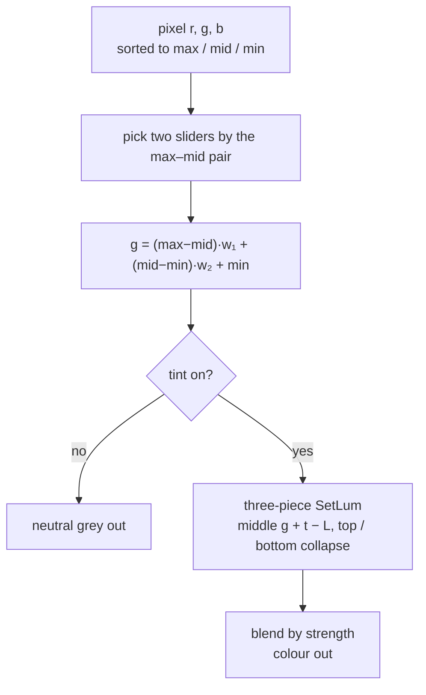

`lb:rgb-domain-grayscale` · menu **Colors → SuperMrWang → Tone → Black & White** ·
`GeglOperationPointFilter` (per-pixel)

## What it does

Six hue sliders — red, yellow, green, cyan, blue, magenta — decide how strongly each
colour in the image contributes to the grey result, and the grey can then be tinted.
This is the classic editor's Black & White dialog: pull blue down and a blue sky goes dark,
push yellow up and skin brightens, without any of it touching the rest of the frame.

The three RGB channels are combined with the six hue weights summed; the slider range
−200…300 matches the the classic editor dialog, and the defaults (red 40, yellow 60, green 40,
cyan 60, blue 20, magenta 80) are the classic editor's.

## How the tint works

The tint is calibrated black-box against the classic editor (18 tints, per-code
agreement — see `bw-cal/RESULTS.md`). It is not a `grey × colour` multiply. With
tint $t=(t_R,t_G,t_B)$ and NTSC luma $L = 0.3\,t_R + 0.59\,t_G + 0.11\,t_B$
(encoding domain), each output channel is

```math
\text{out}_{ch} = \begin{cases}
(t_{ch}-t_{\min})\cdot \dfrac{g}{\,L-t_{\min}\,}, & g \le L-t_{\min} \quad \text{(bottom)} \\[8pt]
g + t_{ch} - L, & \text{otherwise} \quad \text{(middle)} \\[8pt]
1-(t_{\max}-t_{ch})\cdot \dfrac{1-g}{\,t_{\max}-L\,}, & g \ge 1-(t_{\max}-L) \quad \text{(top)}
\end{cases}
```

and then pulled back toward grey by strength, $\text{out}_{ch} \leftarrow
g + (\text{out}_{ch}-g)\cdot s$. The pieces join continuously and the outer two pass
exactly through white and black, so tinting never crushes the tonal range —
highlights stay highlights.



## Parameters

| Parameter | Default | Notes |
|---|---|---|
| `red` / `yellow` / `green` | 40 / 60 / 40 | Weight of each hue family, −200…300 |
| `cyan` / `blue` / `magenta` | 60 / 20 / 80 | Weight of each hue family, −200…300 |
| `tint_enabled` | off | Tint the grey result |
| `tint_color` | `#E0D4B2` | Tint colour (a warm sepia by default) |
| `tint_strength` | 1 | How strongly the tint is applied, 0…1 |

## Notes

- The operator runs per pixel in the 8-bit sRGB gamma domain, so the weights behave
  like the ones in the classic editor's dialog.
- Alpha is preserved; transparent pixels stay transparent.
- Unlike GIMP's `Colors → Desaturate`, the conversion is not a fixed luma formula: you
  choose what each colour becomes, which is the whole point of Black & White.
