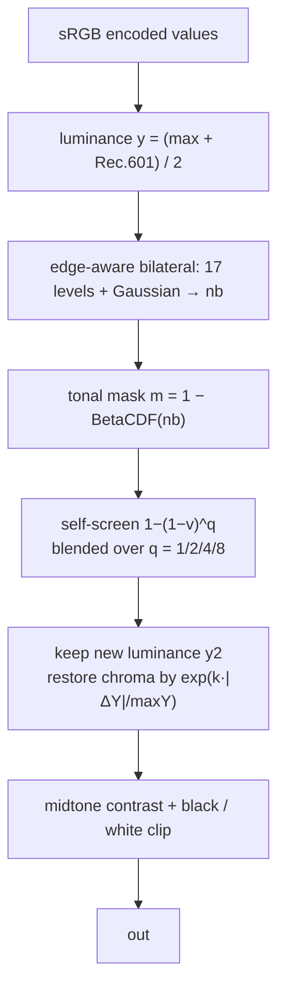

> **Not recommended for daily use (2026-11-15, performance).** The operator still works
> and is still numerically accurate, but it is a spatial algorithm: about 1.4 µs per
> pixel at radius 30, so a 2048×1536 image takes 0.7 s of compute (2.1 s including
> decode), and every slider drag in GIMP recomputes the whole image. For overall
> brightness use `lb:levels` / `lb:lab-levels` / `lb:exposure`; come back here only when
> you need the local "lift less where the surroundings are bright" behaviour, and drop
> the radius to 10–15 for a big speedup. Marker: `ops/shadows-highlights/.discouraged`
> (documentation and site display only; **it does not affect building or publishing**).

the classic editor's `Image → Adjustments → Shadows/Highlights`, matched as a black
box. What sets it apart from the other operators is that **it looks at the
neighbourhood**: the same 128 pixel is lifted more when its surroundings are dark and
less when they are bright, so it cannot collapse into a LUT and needs a spatial filter.

- GEGL id: `lb:shadows-highlights`
- Menu: `Colors → SuperMrWang → Tone → Shadows/Highlights`
- Type: `GeglOperationFilter` (spatial, processed in strips of 192 rows)
- Parameters (defaults copied from the classic editor): shadows `amount 35 / width 50 / radius 30`,
  highlights `0 / 50 / 30`, `color-correction 20`, `midtone-contrast 0`, `black-clip
  0.01`, `white-clip 0.01`

## One trap first: the classic editor's scripting entry is not called Shadow/Highlight

To use the classic editor as an oracle you first have to be able to invoke it from a script. `Shdw`,
`ShHl`, `shadowsHighlights`, `shadowHighlight`, `adaptCorrectTones` … 13 charIDs and 8
stringIDs, all reporting "command <unknown> is not currently available", and the string
`shadowsHighlights` does not appear anywhere in `the editor process` or `Required/*.dll`.

The real entry is **`adaptCorrect`**, class `adaptCorrectTones`:

```javascript
var d = new ActionDescriptor();
d.putObject(s2t("shadowMode"),    s2t("adaptCorrectTones"), tones(sh));
d.putObject(s2t("highlightMode"), s2t("adaptCorrectTones"), tones(hi));
d.putDouble (s2t("blackClip"), 0.01);
d.putDouble (s2t("whiteClip"), 0.01);
d.putInteger(s2t("colorCorrection"), 20);
executeAction(s2t("adaptCorrect"), d, DialogModes.NO);
```

`shadowMode`/`highlightMode` then hold `amount`/`width`/`radius` (`#Prc`), everything
else being lowercase stringIDs. The lead came from a Clean SL script in the vendor's
community and was far faster than guessing IDs.

## Structure

Six stages, all numbers from black-box fitting against the classic editor 25.4 (PhotoCraft uses the same
structure, MIT):

1. **Luminance**: the mean of the max channel and Rec.601 luma, applied to **sRGB
   encoded values** (not linear light). That is why lifting the shadows makes colours
   look washed out — it moves display values:

```math
y = \tfrac{1}{2}\bigl(\max(R,G,B) + 0.299R + 0.587G + 0.114B\bigr)
```
2. **Neighbourhood luminance**: an edge-aware bilateral in Durand–Dorsey's piecewise
   linear form. `lum` is first blurred lightly (σ=1.3559) into a `guide` (noise
   suppression only; it does not set the scale); pixels are quantised into **17 levels**
   by `guide`, each level averaged separately with weight `w = 1 − |lum − g|/1.0152`;
   sums are accumulated on a grid of `d = ⌊σ/4⌋` and blurred with a Gaussian of **σ =
   1.1424·radius**; finally the fractional level interpolates between neighbouring
   levels and is bilinearly upsampled to full resolution. The effect is "average only
   with neighbours of similar brightness", so the two sides of an edge stay separate.
3. **Tonal mask**: `nb` indexes a 256-entry table `1 − BetaCDF(level)`. The shape
   interpolates between Beta(a,b) by tonal width: 0 → Beta(1.95, 23) (only the darkest
   sliver), ≥95 → `1 − L` (everything). Highlights mirror it with `255 − nb`.
4. **Curve**: a self-screen $c_q(v) = 1-(1-v)^q$, with $q \in \{1,2,4,8\}$ blended by
   amount $A$:

```math
u = \left(\frac{A}{100}\right)^{0.6216},\qquad
s = \begin{cases}
u/0.3, & u \le 0.3 \\[4pt]
(1+20u)/7, & u > 0.3
\end{cases}
\qquad\Longrightarrow\qquad A = 15 \approx 1,\ 50 \approx 2,\ 100 \approx 3
```

   Shadows lift each channel by $m\cdot s\,\bigl(c_q(y)-y\bigr)$; highlights push back
   with the mirror.
5. **Colour**: keep only the new luminance `y2`; the chroma difference comes from the
   **original** pixel `q` minus its own luminance `y1`, scaled by
   `exp(k·|ΔY|/maxY)` (for negative values `1 + k·|ΔY|/maxY`) and added back, then
   everything is brought into gamut.
6. **Midtone contrast**: a global S-curve on luminance,
   `y + k(y−0.5)(4y(1−y))^p`, pivoting exactly at 0.5; **black/white clip** is a
   **stretch** of the histogram ends.



Stages five and six as formulas:

```math
\text{out}_{ch} = y_2 + (q_{ch}-y_1)\cdot
\begin{cases}
\exp\!\bigl(k\,|\Delta Y|/\max Y\bigr), & \Delta Y \ge 0 \\[6pt]
1 + k\,|\Delta Y|/\max Y, & \Delta Y < 0
\end{cases}
\qquad
y'' = y_2 + k\,(y_2-0.5)\bigl(4y_2(1-y_2)\bigr)^p
```

## Two counter-intuitive measurements

**The default 0.01% clip really does change the picture.** The first probe used 16 grey
bands (16…240); the outer two were always pulled to 0/255, which looked like crosstalk.
In fact `blackClip`/`whiteClip` percentages are **relative to the histogram**: the probe
had no 0 or 255, so 0.01% treated the darkest band as the black point. A 129-band ramp
that includes 0 and 255 removed the artefact; the control pair `a100/clip0` vs
`a100/clip01` shows black patch 0 vs 7 and background 91 vs 87, plainly.

**Radius does not change the blur width, but the fraction of bright pixels in the
neighbourhood.** On a step edge (12 on the left, 240 on the right), raising the radius
from 0 to 100 moves the plateau far from the edge monotonically from 73 to 65, while the
pixel right at the bright edge stays at 48–50. The edge-aware weight suppresses bright
neighbours to about 12%, so the transition is only 1–2 pixels wide; a larger radius just
pulls more bright pixels into the window and slowly raises `nb`. Tuning σ by pure
Gaussian intuition does not work.

## Performance

The flat-field part is a 256-entry lookup; the cost is all in the neighbourhood: 17
levels × 4 Gaussian passes. 192-row strips bound the memory: `ramp-2.png` (25800×160,
129 bands) takes 3.2 s and `grid-b016.png` (2560×2560) 4.7 s, both wall-clock including
PNG encode/decode. About 1.4 µs per pixel at radius 30.

## Acceptance

`python tools/check_shadows_highlights.py` (`--fast` skips the the classic editor comparison):

**1. Independent Python reference vs the operator** (flat field, nb = itself). The
reference is written straight from the six stages above, sharing only the fitted
coefficient tables, not the C code:

| Check | Sets | Max deviation |
|---|---|---|
| greyscale flat-field LUT | 6 sets × 29 steps | **0.0 code** (exact per point) |
| colour flat field (color-correction +100…−100) | 4 sets × 6 colours | **0.0 code** |
| amount=0 identity / flat field independent of radius | 2 checks | **0.0 code** |
| midtone pivot at 128, default clip keeps 0 and 255 | 2 checks | pass |

Writing that script caught a real bug: with both clips at 0, `clip_lo/clip_hi` were
uninitialised and `(y−0)/(0−0)` pushed the whole image to pure white. `prepare()` now
resets them to 0/1 and the division has a guard.

**2. Against the classic editor itself** (`shadows-highlights-cal/`):

| Dataset | Size | Median | Max |
|---|---|---|---|
| flat-field vertical bands (17 settings) | 17×129 | 0.5 code | **5.7 code** (`h_a100_w0`) |
| 2D grid (14 backgrounds) | 14×256 | 1.0 code | **11.1 code** (`grid_h_b240`) |

Flat fields are the strong case: 14 of 17 sets are within 3 code values, and the shadow
side is always within 2.6. On the 2D grid, 9 sets are within 7, median 1.0.

## Known deviations

1. **2D grids with extreme local contrast** (a 20×20 patch on a background covering 99%
   of the area, `bg=16` with a bright patch and `bg=240` with a dark one) are off by up
   to 11 code values. Flat fields agree and only these synthetic patterns — where the
   neighbourhood differs from the pixel by 200 code values or more — do not, which says
   the edge preservation is slightly too weak: the classic editor's `nb` sticks closer to the pixel
   itself. Lowering `SH_RANGE` below 1.0152 (stronger edge preservation) improves 87% of
   points but creates 87-code outliers; raising it (4.0 / 50, toward a plain Gaussian)
   only gets worse. 1.0152 is the measured local optimum, so it stays and this tail
   remains.
2. **The 5.7 codes of `h_a100_w0`**: at tonal width 0 the mask degenerates to
   Beta(1.95, 23), a steep wall in the darkest segment; the lookup table is built in
   steps of 5 in width, and width 0 sits exactly on the first node where the error is
   most sensitive.
3. **Radius > 300 is not calibrated**: the classic editor's dialog goes to 2500, calibration stopped at
   300, and larger radii extrapolate with the same σ = 1.1424·r.
4. `midtone_contrast` and `color_correction` use the reference implementation's fitted
   coefficients and were **not measured against the classic editor separately** (the flat and colour
   flat tests only prove the operator agrees with the reference, not with the classic editor).

## Reproducing the calibration

`shadows-highlights-cal/` holds the whole set: `apply_cases.jsx` (the classic editor-side runner),
`run_cases.py` (batch run + read results), `make_ramp.py` / `make_grid.py` (three probe
sets: greyscale bands, 2D grid, step edge), `compare_op.py` (per-point comparison),
`dump_grid.py` / `analyze_nb.py` (single-case residuals and neighbourhood back-solving),
`sweep.py` (neighbourhood-scale sweep).

---

## Performance (rewritten 2026-11-12)

Three root causes of the sluggishness, all fixed:

1. **GEGL parallelises by column and the margin is repeated per call.** 3M pixels were
   split into 12 vertical strips 171 wide running at once, each carrying the full
   horizontal margin — 2.4× duplication at r30 and **17×** at r300 (margin 1277 px).
   Fix: compute the neighbourhood luminance of the whole extent **once**, cache it as an
   8-bit level plane (the mask lookup uses `lv = lround(clamp(nb)·255)`, lossless at
   8 bits), and let each column sample it. The cache invalidates on parameter change
   (compared in `prepare`), on content change (24-row whole-row hash fingerprints, which
   catch edits to the layer below) and on geometry change.
2. **The black/white clip pre-scan ran the whole pipeline twice.** The default
   0.01/0.01 triggered it. With the cache, the pre-scan reuses the level plane and only
   does a light per-pixel pass.
3. **Per-row `gegl_buffer_set`.** Each 192-row strip called it 192 times; now a strip or
   ROI is written in one call.

Measured (2048×1536, including ~1.3 s PNG decode): defaults 3.7 s → 2.1 s; r300 9.8 s →
2.1 s (compute 7.9 s → 0.7 s, **~11×**). Numbers are **bit-identical** to the old
implementation (four extreme parameter sets cross-checked: cache path = fallback path =
old implementation).

Very large images, or a margin over budget (`SH_CACHE_MAXPX` 20MP /
`SH_CACHE_BUDGET`), fall back to in-place per-strip computation; `SH_NO_CACHE=1` forces
the fallback (for debugging). Strip height adapts to the margin (`4×margin`, 192–1024
rows) and luminance is fetched in chunks (~32 MB each) to bound peak memory.
